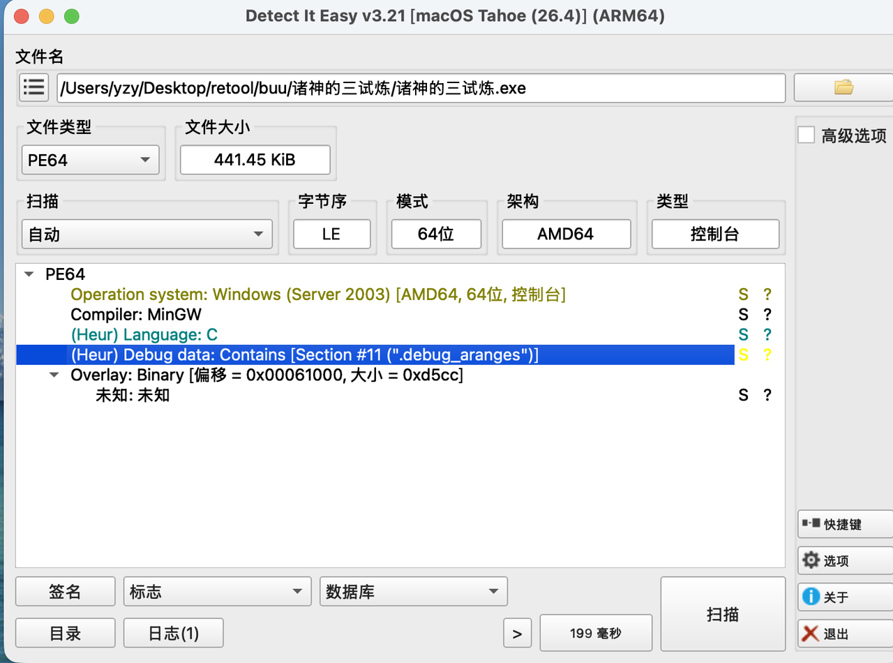
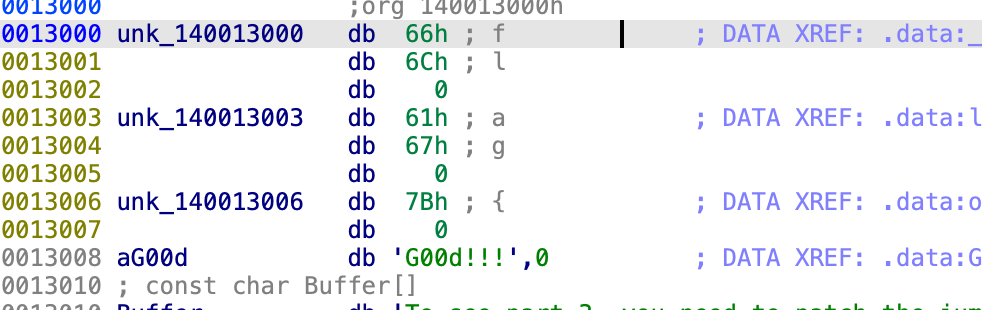
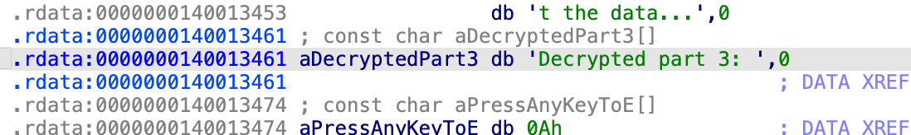
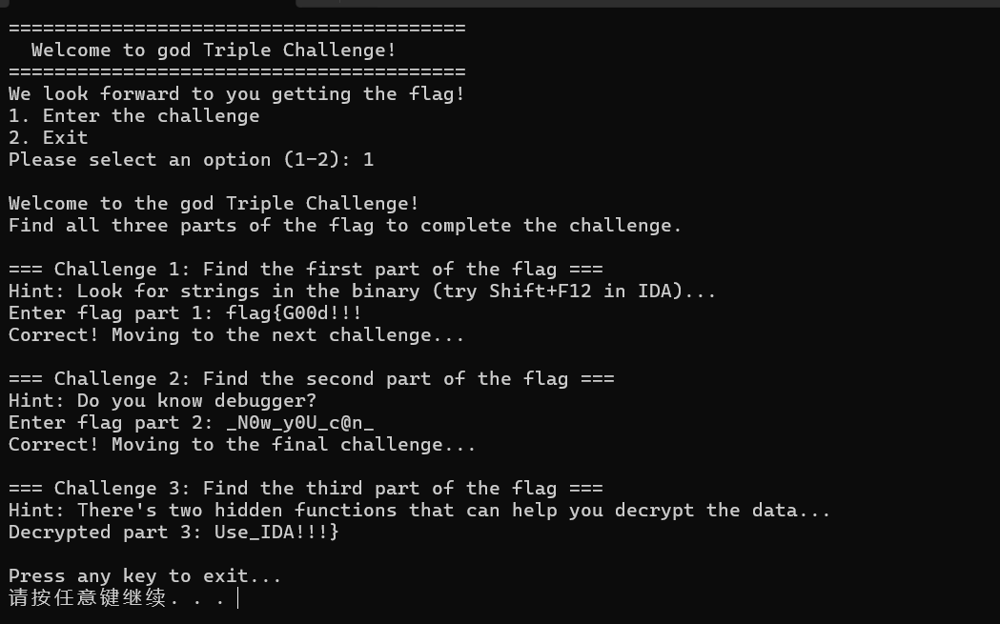

# 诸神的三试炼：分段找字符串与修改跳转

本题是 Windows x64 控制台程序。按题目顺序找出前两段，第三段让原本进入假函数的控制流跳到真正的解密函数，最后把三段拼起来。



截图中的 Detect It Easy 将附件识别为 PE64、AMD64，编译器为 MinGW，并显示有调试信息。选 IDA 的 64 位模式打开，再从 `main` 和字符串交叉引用入手。

## 第一关：拼接字符串



图中能看到 `fl`、`ag`、`{` 和 `G00d!!!`。本地附件的 `flag1` 会把这些片段拼接后与输入比较，因此第一关输入：

```text
flag{G00d!!!
```

注意这里是两个数字 `0`，而且输入的是第一段，还没有闭合大括号。

## 第二关：动调观察数据

`main` 调用 `flag2`；`flag2` 四次调用 `get_data` 取数。可以在 `get_data` 返回后观察 EAX，或在拼装完成后查看缓冲区。静态反汇编中的四个返回值按小端字节读出来分别是：

```text
5f 4e 30 77  →  _N0w
5f 79 30 55  →  _y0U
5f 63 40 6e  →  _c@n
5f           →  _
```

按顺序填入第二关：`_N0w_y0U_c@n_`。留意 `N0w`、`y0U` 中的是数字 `0`，`c@n` 中是 `@`。

## 第三关：修改假函数入口的跳转



图片中的 `Decrypted part 3:` 是解密后打印结果的提示，可通过字符串交叉引用定位输出代码。本地附件的 `main` 在第三关调用 `flag3_fake`；真正处理并打印第三段的函数是 `gift2`，它按固定种子生成的数值对 `encrypted` 数据逐字节做 XOR。

原始附件在 `flag3_fake` 入口的前 5 个字节是 `55 48 89 e5 48`，属于函数开头的指令。已修改版本将这 5 个字节改为：

```asm
; 原附件的首选映像基址下，实际运行地址需加当前模块基址
140001708: e9 33 02 00 00   jmp 140001940   ; gift2
```

调试时可以在 `flag3_fake` 入口把指令改成跳往 `gift2`，或按调试器的汇编修改功能填写对应目标后继续运行。`e9` 后的相对位移从下一条指令地址计算：`0x140001940 - 0x14000170d = 0x233`，所以编码为小端字节 `33 02 00 00`。如果程序因 ASLR 装载到别的基址，应按当前模块基址加 RVA `0x1708`、`0x1940` 定位，不要盲用图中绝对地址。

仓库保留两份附件：[原始 EXE](诸神的三试炼.exe) 来自下载 ZIP；[已修改 EXE](诸神的三试炼_已修改.exe) 来自本地原有文件，恰好在入口处与原版相差上述 5 字节。建议在调试器内修改内存或使用副本，便于对照原始控制流。

## 运行结果与拼接



用户提供的运行截图显示前两关依次通过，第三关输出 `Use_IDA!!!}`。按顺序拼接三段：

```text
flag{G00d!!!_N0w_y0U_c@n_Use_IDA!!!}
```

本页的函数位置、字节和两份附件差异来自本地静态核对；运行结果来自上面的用户截图，本次没有重新启动 Windows 程序。
